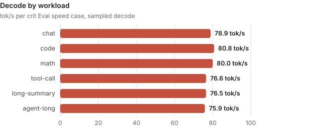

<!-- Rendered by tools/card.py from card.yaml: edit card.yaml, then run python -B tools/card.py on this folder. -->

# gguf-mmq-int4kv

### rtx5060ti · gemma-4-26b-a4b@UD-IQ4-XS

> [!NOTE]
> **Contributed by** [Dualshok3](https://github.com/Dualshok3)

| Quality mode | Decode (sampled) | Decode (greedy) | Prefill | TTFT | Perplexity | Mean KL divergence | Context |
| :---: | :---: | :---: | :---: | :---: | :---: | :---: | :---: |
| speed (rows: decode row-exact, prompt row-exact) | **86.5 tok/s** | **97.9 tok/s** | **3,089 tok/s** | **326 ms** | **+1.2% vs reference** | **1.2** | **200,000 tok** |

- **Measured with:** crit Eval (crit-eval-v0.8.1, decode sampled at the model's defaults) · [crit-eval.json](evidence/crit-eval.json)
- **Track:** open: any choice the protocol allows (a budget of its own, drafter, settings per case)
- **Quality mode:** speed: drift from the checkpoint the user selected traded for speed, judged by a wider budget of its own that only keeps out a broken engine, whatever format the checkpoint is stored in; the worst path uses 87.4% of its quality budget; rows: decode row-exact, prompt row-exact ([exactness](https://github.com/crit-labs/crit/blob/main/kernels/README.md#exactness))
- **Hardware:** Windows 11; AMD Ryzen 5 3600 6-Core Processor (6/12 cores); 16 GiB RAM; NVIDIA GeForce RTX 5060 Ti 16 GiB, PCIe 3.0 x16 (GPU supports 5.0)
- **Further figures:** long-context decode 66.4 tok/s · held-out decode 86.4 tok/s
- **Throughput:** 76.8 tok/s at concurrency 1 · 105.4 tok/s at concurrency 2 · 118.0 tok/s at concurrency 4 · 124.0 tok/s at concurrency 8 (aggregate of the concurrent requests; crit Eval)
- **Requires:** Windows · sm_120 · 16 GB GPU memory · CUDA 13.4 · crit 0.23.0, torch 2.14.1+cu130, MSVC 18 Build Tools
- **Checkpoint** (`gemma-4-26b-a4b@UD-IQ4-XS`): [`unsloth/gemma-4-26B-A4B-it-GGUF`](https://huggingface.co/unsloth/gemma-4-26B-A4B-it-GGUF/tree/c099eb48e663fd284577b04978a94ffccb261841) at `c099eb48`
- **Source:** [crit-labs/crit-engines/gguf-mmq-int4kv @ `3c0ad1d0`](https://github.com/crit-labs/crit-engines/tree/3c0ad1d0b1fb1dfbdeeba88df482394f0a6a3dc4/gguf-mmq-int4kv)
- **Built:** 264.132 h · 24 candidates · 561.8M agent tokens · $174.89 API-equivalent · by Claude Code (Claude Opus 5.5)
- **License:** Apache-2.0

- A plugin package on crit Core (crit 0.23), built in 24 candidates on crit 0.21 and ported to crit 0.23 as candidate 25: its own model, attention, norms and router plugins for Gemma 4's layout (sliding and full attention layers, 128 experts, 8 a token, beside a dense MLP), and GGUF projection and expert plugins, which crit's library did not have
- Runs Gemma 4 26B-A4B from unsloth's UD-IQ4_XS GGUF blocks as stored, judged in crit Eval's `speed` quality mode under a quality budget of its own (open track)
- 200,000 tokens of context on a 16 GB RTX 5060 Ti, INT4 KV pages
- Gemma 4's tool calls (OpenAI `tool_calls`, streamed) and its thinking channel as `reasoning_content`, through the model plugin's own `tool_format` and `reasoning_format`

---

## Design

| Slot | Plugin and settings |
| --- | --- |
| Weights | The GGUF's quantized blocks on the device as stored, nothing re-encoded; the memory map released after load (about 10 GB of host memory) |
| Model | `gemma4-model`: prompt chunks of 512 rows to position 98,304, then 256; captured decode graphs; the experts beside the dense MLP on a side stream; 2 requests at once |
| Projections | `gguf-projections`: dp4a GEMVs straight from the blocks for decode, int8 tensor-core mmq tiles from the blocks for prompts (stored activations), tiled router logits |
| Experts | `gguf-experts`: device-sorted expert routes, the same block kernels |
| KV cache and attention | `gemma4-attention`: sliding-window rings and derived-key full-attention pages in INT4 (block 1024), tensor-core split-KV decode attention, fused prompt attention, page tables cached on the device |
| Other | `gemma4-norms` (fused norms and residuals), `gemma4-router` (softmax scoring, renormalized top-k), `token-sampling`, `device-placement`, a prompt path without host synchronizations |

---

## Measured


| Measurement | Value |
| :--- | ---: |
| Decode, sampled (temperature 1.0, top-p 0.95, top-k 64) | 86.5 tok/s |
| Decode, greedy | 97.9 tok/s |
| Prefill | 3,089 tok/s, 83% of its ceiling |
| Time to first token | 326 ms |
| Whole requests, end to end | 67.1 tok/s |
| Held-out prompts, decode | 86.4 tok/s |
| Long context, decode | 66.4 tok/s |
| Long context, first token | 57.0 s |
| Follow-up turn, first token | 2.7 s |
| Perplexity vs reference, worst path | +1.2% (long-4096/served) |
| KL divergence, worst path | mean 1.202, p99 11.37 (long-32768/prompt) |
| Top-1 agreement, lowest | 61.7% (long-32768/prompt) |
| Quality budget used | 87% (long-32768/prompt) |
| Quality budget | PPL ×1.4, KLD mean 1.5, p99 13.0 |
| Decode step | 10.2 ms, against 8.7 ms of reads (86%) |
| Context | 200,000 tokens |
| VRAM free at the full context | 1.16 GB |
| Load time | 142.9 s |

| Speed case | Prompt tokens | Decode, sampled | Decode, greedy | First token |
| :--- | ---: | ---: | ---: | ---: |
| chat | 84 | 89.5 tok/s | 99.7 tok/s | 67 ms |
| code | 102 | 89.4 tok/s | 100.3 tok/s | 70 ms |
| math | 214 | 83.3 tok/s | 100.5 tok/s | 91 ms |
| tool-call | 1,938 | 86.7 tok/s | 96.9 tok/s | 586 ms |
| long-summary | 3,584 | 84.7 tok/s | 95.0 tok/s | 1.1 s |
| agent-long | 14,336 | 85.7 tok/s | 95.3 tok/s | 5.0 s |

| Context | Decode | First token | Prefill |
| :--- | ---: | ---: | ---: |
| 32,768 | 78.2 tok/s | 13.4 s | 2,341 tok/s |
| 200,000 | 56.3 tok/s | 243.1 s | 821.5 tok/s |

- crit Eval (crit-eval 0.8.1) of sealed candidate-0025, certified, at 200,000 tokens of context, on Windows 11 with an RTX 5060 Ti 16 GB
- Candidate 25 is candidate 24's engine on crit 0.23's library; the engine's own plugins are unchanged. Candidate 24's certified Eval on crit 0.21 (crit-eval 0.7.1, with other processes taking about 7 CPU cores) measured sampled decode 78.1 tok/s, prefill 3,006 tok/s, TTFT 339 ms, the same quality
- The run's own benchmark measured sampled decode at 84.8 to 88.8 tok/s and TTFT at 151 ms, with 9.75 GiB of host RAM and 1.67 GiB of VRAM free
- Quality is scored against `crit eval reference` of the same GGUF: the INT4 KV drifts on prompt positions (mean KL divergence 0.85 to 1.20), continuation positions stay close (0.03 to 0.08)
- Long-context decode is bound by the split-KV decode attention over 200,000 positions



---

## Checks

- **Gates:** every gate of the certified Eval passed: coverage, repeatable, request history, prompt cache, quality (under the run's budget: perplexity ratio 1.4, mean KL divergence 1.5, p99 13.0), sampling, capacity at 200,000 tokens, retrieval, lower context and concurrency; generality judged afterwards against candidate 24 (this engine on crit 0.22), both served and measured by crit-eval 0.8.1 on the held-out prompts alone with the same data and jitter seed, three runs each: held-out decode 88.7 against 87.5 tok/s (+1.4%), a pass in 8 of 9 pairings; the one miss is a single prompt (Arabic) 10.6% slower, as far as candidate 24 swings against itself. The certified Eval's own held-out figure passes against 2 of the 3 runs
- **Functional:** `crit run serve --check` passed the plugin tests, the serving checks (tool calls included) and Eval's pre-check; crit smoke left out (the checkpoint fails its fluency limit under every crit since 0.19, llama.cpp scores it alike)
- **Resources:** at least 1 GiB of device memory free at every step of a 200,000-token prompt, 2 GiB of host memory free in the benchmark; slowest prompt step under 1 s
- **Track:** open: judged under the run's own quality budget, wider than `speed`'s protocol budget (mean KL divergence 0.4, p99 4.0)

---

## Limits

- Misses `speed`'s protocol quality budget: the INT4 KV codes flip single positions of this very confident checkpoint; FP8 KV halves the drift but does not fit 200,000 tokens in 16 GB
- No prompt cache: a follow-up turn prefills its whole prompt again; a 200,000-token prompt takes about 58 s to its first token
- Constrained JSON (`response_format`) through crit's compact grammar: the model writes `": "` into the first string value, clients strip it
- Needs crit 0.23: crit 0.23 runs no engine sealed with an earlier library (the version for crit 0.21/0.22 is crit-engines `e5363b64`)
- Built and run only on Windows 11 with MSVC 18 Build Tools, CUDA 13.4, Python 3.14 and torch 2.14.1+cu130, on one RTX 5060 Ti (sm_120)
- The checkpoint folder combines two repositories: the GGUF from unsloth/gemma-4-26B-A4B-it-GGUF, the config, tokenizer and chat template from google/gemma-4-26B-A4B-it at `4d7ae4984b7db7de8f8457170b3f1a419ee76d52`, plus the run's `download.json`

---

## Build and chat

```sh
git clone https://github.com/crit-labs/crit-engines && git -C crit-engines checkout 3c0ad1d0b1fb1dfbdeeba88df482394f0a6a3dc4
```

- Assemble the checkpoint folder: `gemma-4-26B-A4B-it-UD-IQ4_XS.gguf` from the unsloth repository at the pinned revision; `config.json`, `tokenizer.json`, `tokenizer_config.json`, `generation_config.json` and `chat_template.jinja` from google/gemma-4-26B-A4B-it at `4d7ae49`; and `download.json`, written byte for byte by:

  ```sh
  python -c "import json; open('download.json','wb').write(json.dumps({'repository':'unsloth/gemma-4-26B-A4B-it-GGUF','filename':'gemma-4-26B-A4B-it-UD-IQ4_XS.gguf','url':'https://huggingface.co/unsloth/gemma-4-26B-A4B-it-GGUF/resolve/main/gemma-4-26B-A4B-it-UD-IQ4_XS.gguf','size':13597177568,'sha256':'babd1e389d386352f71600765d37390f7dc993fbfad6725caccf996ffe34aecf'},indent=2).replace(chr(10),chr(13)+chr(10)).encode())"
  ```

- Check it from a crit-hub checkout: `python -B tools/verify_model.py engines/Dualshok3/gguf-mmq-int4kv <checkpoint folder>`
- Install and serve it from a shell with the MSVC developer environment (the kernels build at load) and crit 0.23.0:

  ```sh
  crit pull Dualshok3/gguf-mmq-int4kv --engines crit-engines --model <checkpoint folder> --context 200000
  crit serve --engine Dualshok3/gguf-mmq-int4kv
  ```

- `engine/build.py` runs `engine/build.cmd`: MSVC's `vcvars64.bat`, CUDA 13.4's nvcc (`CUDA_HOME`), then each plugin's `build_kernels.py` with the Python that runs crit
- Chat at `http://127.0.0.1:8000/v1` (OpenAI-compatible)

---

## Benchmark your machine

```sh
crit pull Dualshok3/gguf-mmq-int4kv
crit bench Dualshok3/gguf-mmq-int4kv --data <a folder for crit Eval's data> --out result.json
crit hub report Dualshok3/gguf-mmq-int4kv result.json --hub <your crit-hub checkout> --by <your GitHub account>
```

- `crit bench` prepares crit Eval's data from the checkpoint `crit pull` installed, runs its speed suite (and quality
  where the data holds the reference's scores) and prints this card's stats beside yours
- `crit hub report` adds your result file under `evidence/` and to this card, as a reproduction of the GPU and model
  it measured or as a new result, for a pull request to crit-hub

---

## Credits

Credits and licenses are in [THIRD_PARTY.md](https://github.com/crit-labs/crit-engines/blob/3c0ad1d0b1fb1dfbdeeba88df482394f0a6a3dc4/gguf-mmq-int4kv/THIRD_PARTY.md) and [LICENSES.txt](https://github.com/crit-labs/crit-engines/blob/3c0ad1d0b1fb1dfbdeeba88df482394f0a6a3dc4/gguf-mmq-int4kv/LICENSES.txt), next to the source. The GGUF block decoders use ggml's IQ3_S codebook and GGUF block layouts (MIT).
