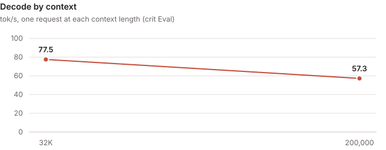

<!-- Rendered by tools/card.py from card.yaml: edit card.yaml, then run python -B tools/card.py on this folder. -->

# gguf-mmq-int4kv

### rtx5060ti · gemma-4-26b-a4b@UD-IQ4-XS

> [!NOTE]
> **Contributed by** [Dualshok3](https://github.com/Dualshok3)

| Quality mode | Decode (sampled) | Decode (greedy) | Prefill | TTFT | Perplexity | Mean KL divergence | Context |
| :---: | :---: | :---: | :---: | :---: | :---: | :---: | :---: |
| speed | **78.1 tok/s** | **91.9 tok/s** | **3,006 tok/s** | **339 ms** | **+1.2% vs reference** | **1.2** | **200,000 tok** |

- **Measured with:** crit Eval (crit-eval-v0.7.1, decode sampled at the model's defaults) · [crit-eval.json](evidence/crit-eval.json)
- **Track:** open: any choice the protocol allows (a budget of its own, drafter, settings per case)
- **Quality mode:** speed: drift from the checkpoint the user selected traded for speed, judged by a wider budget of its own that only keeps out a broken engine, whatever format the checkpoint is stored in; the worst path uses 87.4% of its quality budget
- **Hardware:** Windows 11; AMD Ryzen 5 3600 6-Core Processor (6/12 cores); 16 GiB RAM; NVIDIA GeForce RTX 5060 Ti 16 GiB, PCIe 3.0 x16 (GPU supports 5.0)
- **Further figures:** long-context decode 66.6 tok/s · held-out decode 94.8 tok/s
- **Throughput:** 81.2 tok/s at concurrency 1 · 117.5 tok/s at concurrency 2 · 118.6 tok/s at concurrency 4 · 125.3 tok/s at concurrency 8 (aggregate of the concurrent requests; crit Eval)
- **Requires:** Windows · sm_120 · 16 GB GPU memory · CUDA 13.4 · crit 0.22.0 (built on crit 0.21.0 with the package tool_format), torch 2.14.1+cu130, MSVC 18 Build Tools
- **Checkpoint** (`gemma-4-26b-a4b@UD-IQ4-XS`): [`unsloth/gemma-4-26B-A4B-it-GGUF`](https://huggingface.co/unsloth/gemma-4-26B-A4B-it-GGUF/tree/c099eb48e663fd284577b04978a94ffccb261841) at `c099eb48`
- **Source:** [crit-labs/crit-engines/gguf-mmq-int4kv @ `e5363b64`](https://github.com/crit-labs/crit-engines/tree/e5363b642fed155311d532ec06bd002ce705c350/gguf-mmq-int4kv)
- **Built:** 264.132 h · 24 candidates · 561.8M agent tokens · $174.89 API-equivalent · by Claude Code (Claude Opus 5.5)
- **License:** Apache-2.0

- A plugin package on crit Core (crit 0.21), built in 24 candidates: its own model, attention, norms and router plugins for Gemma 4's layout (sliding and full attention layers, 128 experts, 8 a token, beside a dense MLP), and GGUF projection and expert plugins, which crit's library did not have
- Runs Gemma 4 26B-A4B from unsloth's UD-IQ4_XS GGUF blocks as stored, judged in crit Eval's `speed` quality mode under a quality budget of its own (open track)
- 200,000 tokens of context on a 16 GB RTX 5060 Ti, INT4 KV pages
- Gemma 4's tool calls (OpenAI `tool_calls`, streamed) and its thinking channel as `reasoning_content`, through the model plugin's own `tool_format` and `reasoning_format`

---

## Design

| Slot | Plugin and settings |
| --- | --- |
| Weights | The GGUF's quantized blocks on the device as stored, nothing re-encoded; the memory map released after load (about 10 GB of host memory) |
| Model | `gemma4-model`: prompt chunks of 512 rows to position 98,304, then 256; captured decode graphs; the experts beside the dense MLP on a side stream; 2 requests at once |
| Projections | `gguf-projections`: dp4a GEMVs straight from the blocks for decode, int8 tensor-core mmq tiles from the blocks for prompts (stored activations), tiled router logits |
| Experts | `gguf-experts`: device-sorted expert routes, the same block kernels |
| KV cache and attention | `gemma4-attention`: sliding-window rings and derived-key full-attention pages in INT4 (block 1024), tensor-core split-KV decode attention, fused prompt attention, page tables cached on the device |
| Other | `gemma4-norms` (fused norms and residuals), `gemma4-router` (softmax scoring, renormalized top-k), `token-sampling`, `device-placement`, a prompt path without host synchronizations |

---

## Measured



| Measurement | Value |
| :--- | ---: |
| Decode, sampled (temperature 1.0, top-p 0.95, top-k 64) | 78.1 tok/s |
| Decode, greedy | 91.9 tok/s |
| Prefill | 3,006 tok/s, 81% of its ceiling |
| Time to first token | 339 ms |
| Whole requests, end to end | 61.5 tok/s |
| Held-out prompts, decode | 94.8 tok/s |
| Long context, decode | 66.6 tok/s |
| Long context, first token | 57.7 s |
| Follow-up turn, first token | 2.8 s |
| Perplexity vs reference, worst path | +1.2% (long-4096/served) |
| KL divergence, worst path | mean 1.202, p99 11.37 (long-32768/prompt) |
| Top-1 agreement, lowest | 61.7% (long-32768/prompt) |
| Quality budget used | 87% (long-32768/prompt) |
| Quality budget | PPL ×1.4, KLD mean 1.5, p99 13.0 |
| Decode step | 10.7 ms, against 8.7 ms of reads (81%) |
| Context | 200,000 tokens |
| VRAM free at the full context | 1.28 GB |
| Load time | 143.8 s |

| Speed case | Prompt tokens | Decode, sampled | Decode, greedy | First token |
| :--- | ---: | ---: | ---: | ---: |
| chat | 84 | 78.9 tok/s | 93.9 tok/s | 94 ms |
| code | 102 | 80.8 tok/s | 94.5 tok/s | 82 ms |
| math | 214 | 80.0 tok/s | 93.6 tok/s | 96 ms |
| tool-call | 1,938 | 76.6 tok/s | 91.3 tok/s | 599 ms |
| long-summary | 3,584 | 76.5 tok/s | 89.1 tok/s | 1.1 s |
| agent-long | 14,336 | 75.9 tok/s | 89.2 tok/s | 5.1 s |

| Context | Decode | First token | Prefill |
| :--- | ---: | ---: | ---: |
| 32,768 | 77.5 tok/s | 13.6 s | 2,306 tok/s |
| 200,000 | 57.3 tok/s | 244.9 s | 815.6 tok/s |

- crit Eval (crit-eval-v0.7.1) of sealed candidate-0024, certified, at 200,000 tokens of context, on Windows 11 with an RTX 5060 Ti 16 GB
- The Eval ran while other processes on the machine took about 7 CPU cores: its sampled decode (78.1 tok/s) carries that load. The same server measured with `crit eval run --url` on an idle machine: sampled decode 86.0 tok/s, greedy 97.8, prefill 3,086 tok/s, TTFT 325 ms (not part of the evidence)
- Quality is scored against `crit eval reference` of the same GGUF: the INT4 KV drifts on prompt positions (mean KL divergence 0.85 to 1.20), continuation positions stay close (0.03 to 0.08)
- Long-context decode is bound by the split-KV decode attention over 200,000 positions


---

## Checks

- **Gates:** every gate of the certified Eval passed: coverage, repeatable, request history, prompt cache, quality (under the run's budget: perplexity ratio 1.4, mean KL divergence 1.5, p99 13.0), sampling, capacity at 200,000 tokens, retrieval, lower context and concurrency; generality reported
- **Functional:** `crit run serve --check` passed the plugin tests, the serving checks (tool calls included) and Eval's pre-check; crit smoke left out (the checkpoint fails its fluency limit, llama.cpp scores it alike)
- **Resources:** at least 1 GiB of device memory free at every step of a 200,000-token prompt, 2 GiB of host memory free in the benchmark; slowest prompt step under 1 s
- **Track:** open: judged under the run's own quality budget, wider than `speed`'s protocol budget (mean KL divergence 0.4, p99 4.0)
- **crit 0.22.0:** `crit pull` of this card and `crit serve --engine` on crit 0.22.0 (2026-11-23): chat, streaming, tool calls (plain, streamed, with the tool result), reasoning and `json_schema` passed; a served crit Eval (crit-eval 0.7.3, idle machine) matched the certified build: sampled decode 86.7 tok/s, greedy 98.0, prefill 3,088 tok/s, TTFT 337 ms, the same quality, every gate a server measures passed

---

## Limits

- Misses `speed`'s protocol quality budget: the INT4 KV codes flip single positions of this very confident checkpoint; FP8 KV halves the drift but does not fit 200,000 tokens in 16 GB
- No prompt cache: a follow-up turn prefills its whole prompt again; a 200,000-token prompt takes about 58 s to its first token
- Constrained JSON (`response_format`) through crit's compact grammar: the model writes `": "` into the first string value, clients strip it
- Needs crit 0.22.0 or newer (the package `tool_format` and `reasoning_format`); certified on crit 0.21.0 with that change (crit-labs/crit `3cf231c`)
- Built and run only on Windows 11 with MSVC 18 Build Tools, CUDA 13.4, Python 3.14 and torch 2.14.1+cu130, on one RTX 5060 Ti (sm_120)
- The checkpoint folder combines two repositories: the GGUF from unsloth/gemma-4-26B-A4B-it-GGUF, the config, tokenizer and chat template from google/gemma-4-26B-A4B-it at `4d7ae4984b7db7de8f8457170b3f1a419ee76d52`, plus the run's `download.json`

---

## Build and chat

```sh
git clone https://github.com/crit-labs/crit-engines && git -C crit-engines checkout e5363b642fed155311d532ec06bd002ce705c350
```

- Assemble the checkpoint folder: `gemma-4-26B-A4B-it-UD-IQ4_XS.gguf` from the unsloth repository at the pinned revision; `config.json`, `tokenizer.json`, `tokenizer_config.json`, `generation_config.json` and `chat_template.jinja` from google/gemma-4-26B-A4B-it at `4d7ae49`; and `download.json`, written byte for byte by:

  ```sh
  python -c "import json; open('download.json','wb').write(json.dumps({'repository':'unsloth/gemma-4-26B-A4B-it-GGUF','filename':'gemma-4-26B-A4B-it-UD-IQ4_XS.gguf','url':'https://huggingface.co/unsloth/gemma-4-26B-A4B-it-GGUF/resolve/main/gemma-4-26B-A4B-it-UD-IQ4_XS.gguf','size':13597177568,'sha256':'babd1e389d386352f71600765d37390f7dc993fbfad6725caccf996ffe34aecf'},indent=2).replace(chr(10),chr(13)+chr(10)).encode())"
  ```

- Check it from a crit-hub checkout: `python -B tools/verify_model.py engines/Dualshok3/gguf-mmq-int4kv <checkpoint folder>`
- Install and serve it from a shell with the MSVC developer environment (the kernels build at load) and crit 0.22.0:

  ```sh
  crit pull Dualshok3/gguf-mmq-int4kv --engines crit-engines --model <checkpoint folder> --context 200000
  crit serve --engine Dualshok3/gguf-mmq-int4kv
  ```

- `engine/build.py` runs `engine/build.cmd`: MSVC's `vcvars64.bat`, CUDA 13.4's nvcc (`CUDA_HOME`), then each plugin's `build_kernels.py` with the Python that runs crit
- Chat at `http://127.0.0.1:8000/v1` (OpenAI-compatible)

---

## Benchmark your machine

```sh
crit pull Dualshok3/gguf-mmq-int4kv
crit bench Dualshok3/gguf-mmq-int4kv --data <a folder for crit Eval's data> --out result.json
crit hub report Dualshok3/gguf-mmq-int4kv result.json --hub <your crit-hub checkout> --by <your GitHub account>
```

- `crit bench` prepares crit Eval's data from the checkpoint `crit pull` installed, runs its speed suite (and quality
  where the data holds the reference's scores) and prints this card's stats beside yours
- `crit hub report` adds your result file under `evidence/` and to this card, as a reproduction of the GPU and model
  it measured or as a new result, for a pull request to crit-hub

---

## Credits

Credits and licenses are in [THIRD_PARTY.md](https://github.com/crit-labs/crit-engines/blob/e5363b642fed155311d532ec06bd002ce705c350/gguf-mmq-int4kv/THIRD_PARTY.md) and [LICENSES.txt](https://github.com/crit-labs/crit-engines/blob/e5363b642fed155311d532ec06bd002ce705c350/gguf-mmq-int4kv/LICENSES.txt), next to the source. The GGUF block decoders use ggml's IQ3_S codebook and GGUF block layouts (MIT).
