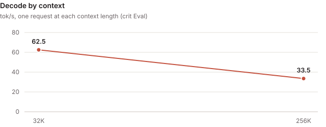
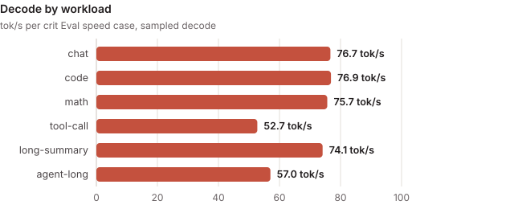

<!-- Rendered by tools/card.py from card.yaml: edit card.yaml, then run python -B tools/card.py on this folder. -->

# gguf-residency-fp8kv

### rtx5060ti · qwen3.6-35b-a3b@UD-IQ4-XS

> [!NOTE]
> **Contributed by** [Dualshok3](https://github.com/Dualshok3)

| Quality mode | Decode (sampled) | Decode (greedy) | Prefill | TTFT | Perplexity | Mean KL divergence | Context |
| :---: | :---: | :---: | :---: | :---: | :---: | :---: | :---: |
| speed (rows: decode row-exact, prompt repeatable) | **68.1 tok/s** | **75.7 tok/s** | **1,026 tok/s** | **1.182 s** | **+0.0% vs reference** | **0.13** | **262,144 tok** |

- **Measured with:** crit Eval (crit-eval-v0.8.1, decode sampled at the model's defaults) · [crit-eval.json](evidence/crit-eval.json)
- **Track:** closed: either quality mode at its protocol budget, one configuration for every workload, and the checkpoint's own draft layers as its only drafter
- **Quality mode:** speed: drift from the checkpoint the user selected traded for speed, judged by a wider budget of its own that only keeps out a broken engine, whatever format the checkpoint is stored in; the worst path uses 74.3% of its quality budget; rows: decode row-exact, prompt repeatable ([exactness](https://github.com/crit-labs/crit/blob/main/kernels/README.md#exactness))
- **Hardware:** Windows 11; AMD Ryzen 5 3600 6-Core Processor (6/12 cores); 16 GiB RAM; NVIDIA GeForce RTX 5060 Ti 16 GiB, PCIe 3.0 x16 (GPU supports 5.0)
- **Further figures:** long-context decode 45.8 tok/s · held-out decode 49.3 tok/s
- **Throughput:** 48.1 tok/s at concurrency 1 · 68.0 tok/s at concurrency 2 · 72.9 tok/s at concurrency 4 · 77.3 tok/s at concurrency 8 (aggregate of the concurrent requests; crit Eval)
- **Requires:** Windows · sm_120 · 16 GB GPU memory · CUDA 13.4 · crit 0.23.0, torch 2.14.1+cu130, MSVC 18 Build Tools, 16 GB host RAM
- **Checkpoint** (`qwen3.6-35b-a3b@UD-IQ4-XS`): [`unsloth/Qwen3.6-35B-A3B-GGUF`](https://huggingface.co/unsloth/Qwen3.6-35B-A3B-GGUF/tree/a483e9e6cbd595906af30beda3187c2663a1118c) at `a483e9e6`
- **Source:** [crit-labs/crit-engines/gguf-residency-fp8kv @ `3c0ad1d0`](https://github.com/crit-labs/crit-engines/tree/3c0ad1d0b1fb1dfbdeeba88df482394f0a6a3dc4/gguf-residency-fp8kv)
- **License:** Apache-2.0

- A plugin package on crit Core (crit 0.23), built in 26 candidates: its own model, attention, recurrence, norms and router plugins for Qwen3.6's hybrid layout (30 Gated DeltaNet layers, 10 full attention layers, 256 experts, 8 a token, beside a shared expert), and GGUF projection and expert plugins, which crit's library did not have
- Runs Qwen3.6-35B-A3B from unsloth's UD-IQ4_XS GGUF blocks (17.7 GB) as stored, judged in crit Eval's `speed` quality mode under its protocol budget (closed track)
- 262,144 tokens of context on a 16 GB RTX 5060 Ti: the model does not fit the GPU, so the most routed experts sit on the device and the rest in pinned host memory
- OpenAI tool calls through crit's serving

---

## Design

| Slot | Plugin and settings |
| --- | --- |
| Weights | The GGUF's quantized blocks (IQ3_S, IQ4_XS, Q6_K, Q8_0) as stored, nothing re-encoded; the pages read through the file map released after load (about 4 GiB of host memory left on a 16 GB machine) |
| Model | `qwen35-model`: captured decode graphs; prompt steps under crit serve's 1 s cancel grace; 2 requests at once |
| Projections | `gguf-projections`: dp4a GEMVs straight from the blocks for decode, int8 tensor-core tiles from the blocks for prompts (Q6_K rows through FP8) |
| Experts | `gguf-experts`: device slots for the most routed experts, the rest in pinned host memory served by an exact AVX2 CPU tier for decode rows and staged over the link for prompt rows; an adaptive residency swaps hot host experts onto the device every 32 decode steps, warmed from each prompt's routes |
| KV cache and attention | `qwen35-attention`: FP8 paged full attention; `qwen35-recurrence`: Gated DeltaNet recurrence kernels |
| Other | `qwen35-norms` (fused norms and gates), `qwen35-router` (softmax top-k), `token-sampling`, `device-placement`, `topk-router`, `torch-norms` |

---

## Measured



| Measurement | Value |
| :--- | ---: |
| Decode, sampled (temperature 1.0, top-p 0.95, top-k 20) | 68.1 tok/s |
| Decode, greedy | 75.7 tok/s |
| Prefill | 1,026 tok/s, 38% of its ceiling |
| Time to first token | 1.2 s |
| Whole requests, end to end | 43.4 tok/s |
| Held-out prompts, decode | 49.3 tok/s |
| Long context, decode | 45.8 tok/s |
| Long context, first token | 227.9 s |
| Follow-up turn, first token | 7.3 s |
| Perplexity vs reference, worst path | -0.0% (conversations/served) |
| KL divergence, worst path | mean 0.128, p99 2.97 (long-32768/prompt) |
| Top-1 agreement, lowest | 90.7% (long-32768/prompt) |
| Quality budget used | 74% (long-32768/prompt) |
| Quality budget | PPL ×1.4, KLD mean 0.4, p99 4.0 |
| Decode step | 11.8 ms, against 6.6 ms of reads (56%) |
| Context | 262,144 tokens |
| VRAM free at the full context | 1.69 GB |
| Load time | 325.5 s |

| Speed case | Prompt tokens | Decode, sampled | Decode, greedy | First token |
| :--- | ---: | ---: | ---: | ---: |
| chat | 87 | 76.7 tok/s | 88.7 tok/s | 246 ms |
| code | 97 | 76.9 tok/s | 85.9 tok/s | 213 ms |
| math | 213 | 75.7 tok/s | 85.9 tok/s | 426 ms |
| tool-call | 2,052 | 52.7 tok/s | 66.8 tok/s | 2.1 s |
| long-summary | 3,584 | 74.1 tok/s | 83.7 tok/s | 3.1 s |
| agent-long | 14,336 | 57.0 tok/s | 51.5 tok/s | 15.2 s |

| Context | Decode | First token | Prefill |
| :--- | ---: | ---: | ---: |
| 32,768 | 62.5 tok/s | 39.8 s | 773.1 tok/s |
| 262,144 | 33.5 tok/s | 1,304.6 s | 200.7 tok/s |

- crit Eval (crit-eval 0.8.1) of sealed candidate-0026, certified, at 262,144 tokens of context, on Windows 11 with an RTX 5060 Ti 16 GB (PCIe 3.0 x16 on this board)
- Quality is scored against `crit eval reference` of the same GGUF; the worst path uses 74.3% of `speed`'s protocol budget
- Decode runs at about 58% of its bandwidth floor: routes to host experts go through the CPU tier
- Prefill is bound by staging host experts over PCIe 3.0
- The run's own benchmark measured sampled decode at 65.8 to 78.2 tok/s and TTFT at 560 to 583 ms, with 4.07 GiB of host RAM and 2.05 GiB of VRAM free



---

## Checks

- **Gates:** every gate of the certified Eval that it judged passed: coverage, repeatable, request history, prompt cache, quality (`speed`'s protocol budget: mean KL divergence 0.4, p99 4.0), sampling, capacity at 262,144 tokens, retrieval, lower context and concurrency; generality not judged (crit-eval 0.8.1 needed freshly prepared data, so its baseline was not comparable)
- **Functional:** `crit run serve --check` passed the plugin tests, crit smoke, the serving checks (streaming, stop strings, cancel, tool calls, logprobs) and Eval's pre-check
- **Resources:** at least 1 GiB of device memory free at every step of a 262,144-token prompt, 2 GiB of host memory free in the benchmark; slowest prompt step under 1 s
- **Track:** closed: judged under `speed`'s protocol budget

---

## Limits

- No prompt cache: Gated DeltaNet's recurrent state is not kept between requests, so a follow-up turn prefills its whole prompt again (about 7 s for an 8,000-token conversation)
- A 262,144-token prompt takes about 22 minutes to its first token: prompt rows of host experts cross PCIe 3.0
- Needs 16 GB of host RAM with about 6 GiB pinned for host experts; other large processes on the machine can leave too little
- Built and run only on Windows 11 with MSVC 18 Build Tools, CUDA 13.4, Python 3.14 and torch 2.14.1+cu130, on one RTX 5060 Ti (sm_120)
- The checkpoint folder is the GGUF alone: crit derives `config.json`, `tokenizer.json`, `tokenizer_config.json`, `chat_template.jinja` and `generation_config.json` from its metadata, byte for byte the files the run measured

---

## Build and chat

```sh
git clone https://github.com/crit-labs/crit-engines && git -C crit-engines checkout 3c0ad1d0b1fb1dfbdeeba88df482394f0a6a3dc4
```

- Put `Qwen3.6-35B-A3B-UD-IQ4_XS.gguf` from the unsloth repository at the pinned revision into an empty folder
- To check it from a crit-hub checkout, first write the derived description files next to it (crit's Python, from that folder), then run `python -B tools/verify_model.py engines/Dualshok3/gguf-residency-fp8kv <checkpoint folder>`:

  ```sh
  python -c "from pathlib import Path; from crit_core.model.gguf import inspect_gguf_model; from crit_core.model.gguf_files import derived_files; [Path(n).write_bytes(d() if callable(d) else d.encode() if isinstance(d, str) else d) for fs in derived_files(inspect_gguf_model(Path('Qwen3.6-35B-A3B-UD-IQ4_XS.gguf'))).values() for n, d in fs.items()]"
  ```

- Install and serve it from a shell with the MSVC developer environment (the kernels build at load) and crit 0.23.0:

  ```sh
  crit pull Dualshok3/gguf-residency-fp8kv --engines crit-engines --model <checkpoint folder> --context 262144
  crit serve --engine Dualshok3/gguf-residency-fp8kv
  ```

- `engine/build.py` runs `engine/build.cmd`: MSVC's `vcvars64.bat`, CUDA 13.4's nvcc (`CUDA_HOME`), then each plugin's `build_kernels.py` with the Python that runs crit
- Chat at `http://127.0.0.1:8000/v1` (OpenAI-compatible)

---

## Benchmark your machine

```sh
crit pull Dualshok3/gguf-residency-fp8kv
crit bench Dualshok3/gguf-residency-fp8kv --data <a folder for crit Eval's data> --out result.json
crit hub report Dualshok3/gguf-residency-fp8kv result.json --hub <your crit-hub checkout> --by <your GitHub account>
```

- `crit bench` prepares crit Eval's data from the checkpoint `crit pull` installed, runs its speed suite (and quality
  where the data holds the reference's scores) and prints this card's stats beside yours
- `crit hub report` adds your result file under `evidence/` and to this card, as a reproduction of the GPU and model
  it measured or as a new result, for a pull request to crit-hub

---

## Credits

Credits and licenses are in [THIRD_PARTY.md](https://github.com/crit-labs/crit-engines/blob/3c0ad1d0b1fb1dfbdeeba88df482394f0a6a3dc4/gguf-residency-fp8kv/THIRD_PARTY.md) and [LICENSES.txt](https://github.com/crit-labs/crit-engines/blob/3c0ad1d0b1fb1dfbdeeba88df482394f0a6a3dc4/gguf-residency-fp8kv/LICENSES.txt), next to the source. The GGUF block decoders use ggml's IQ3_S codebook and GGUF block layouts (MIT).
