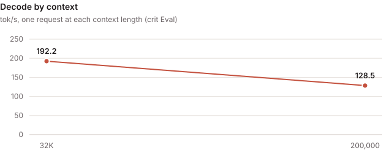
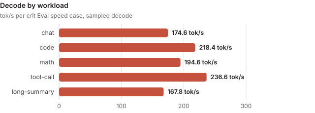

<!-- Rendered by tools/card.py from card.yaml: edit card.yaml, then run python -B tools/card.py on this folder. -->

# block-drafter-fp4-experts

### rtx5090 · inkling-2-mini@NVFP4

> [!NOTE]
> **Contributed by** [crit-labs](https://github.com/crit-labs)

| Quality mode | Decode (sampled) | Decode (greedy) | Prefill | TTFT | Perplexity | Mean KL divergence | Context |
| :---: | :---: | :---: | :---: | :---: | :---: | :---: | :---: |
| speed (rows: decode row-exact, prompt row-exact) | **196.7 tok/s** | **234.4 tok/s** | **8,036 tok/s** | **141 ms** | **+42.0% vs reference** | **0.19** | **200,000 tok** |

- **Measured with:** crit Eval (crit-eval-v0.8.1, decode sampled at the model's defaults) · [crit-eval.json](evidence/crit-eval.json)
- **Track:** open: any choice the protocol allows (a budget of its own, drafter, settings per case)
- **Quality mode:** speed: drift from the checkpoint the user selected traded for speed, judged by a wider budget of its own that only keeps out a broken engine, whatever format the checkpoint is stored in; the worst path uses 79.1% of its quality budget; rows: decode row-exact, prompt row-exact ([exactness](https://github.com/crit-labs/crit/blob/main/kernels/README.md#exactness))
- **Hardware:** Ubuntu 24.04.4 LTS (WSL); AMD Ryzen 5 9600 6-Core Processor (6/12 cores); 79 GiB RAM; NVIDIA GeForce RTX 5090 32 GiB, PCIe 4.0 x16 (GPU supports 5.0)
- **Further figures:** long-context decode 157.2 tok/s · held-out decode 187.3 tok/s
- **Throughput:** 180.4 tok/s at concurrency 1 · 252.1 tok/s at concurrency 2 · 230.1 tok/s at concurrency 4 (aggregate of the concurrent requests; crit Eval)
- **Requires:** WSL2 · sm_120a · 32 GB GPU memory · CUDA 13.1 · crit Core plugin package, crit 0.23.0, torch 2.14.1+cu130, Triton 3.8.0
- **Checkpoint** (`inkling-2-mini@NVFP4`): [`thinkingmachines/Inkling-2-Mini`](https://huggingface.co/thinkingmachines/Inkling-2-Mini/tree/ed40e7da625f594fc9c4990f5f66be24873c22d7) at `ed40e7da`
- **Source:** [crit-labs/crit-engines/block-drafter-fp4-experts @ `d1132180`](https://github.com/crit-labs/crit-engines/tree/d113218017d0969bfa2f3b45a9397d0245b4606f/block-drafter-fp4-experts)
- **License:** Apache-2.0

- A crit plugin package for Inkling-2-Mini, a looped MoE (26.4B total, 3.4B active): layers 6-17 run three times with the same weights, attention residuals over blocks, relative attention with a distance bias; every plugin is a copy of crit's library (`inkling2-loop-model` over the models core `model-template`)
- Runs the official ModelOpt NVFP4 + MXFP8 checkpoint as stored, judged in crit Eval's `speed` quality mode
- Drafts with the checkpoint's own block drafter (`mtp.safetensors`: 3 bidirectional layers and an RNN head) inside Core's captured rounds, up to 7 tokens a round
- 200,000 tokens of context on the 32 GB GPU, FP8 KV pages
- Open track: judged by a quality budget of its own (perplexity ratio 1.6, KLD p99 5.5) instead of the `speed` mode's protocol budget (1.4, 4.0)

---

## Design

| Slot | Plugin and settings |
| --- | --- |
| Model | `inkling2-loop-model` over `model-template`: the looped span's three passes each with their own KV and convolution windows, attention residuals over blocks, relative attention with a distance bias, learned sinks and short convolutions; the block drafter as the draft head, widths 2, 3, 5 and 7 by acceptance rate (`width_policy: rate`), 2 round slots |
| Projections | `quantized-projections`: 16-bit trunk matrices other than the router's re-encoded to FP8 per channel at load, the head in FP8, the drafter's matrices in FP8 (`mtp_encode: fp8`) |
| Experts | `grouped-experts` on the stored NVFP4 experts (layers 0-19) and MXFP8 experts (layers 20-23); NVFP4 prompt rows W4A4 at each route's own scale (fp4-row); `topk-router`: sigmoid scores, top 8, renormalized, scaled by 8 |
| KV cache and attention | `attention-state`: fp8:row paged pools; the drafter's local layers in a doubled ring of window plus block positions; `softmax-attention`: prompt rows on the decode reduction (`prompt_reader: decode`) |
| Prefill | 1,536-token captured prompt chunks, prompt buckets 256, 1,024 and 1,536, prompt steps kept under 0.5 s (`span_seconds`) |
| Tools and reasoning | the model's own tool-call syntax and reasoning markers as the plugin's `tool_format` and `reasoning_format`; replies return reasoning apart from the answer |
| Kernel tuning | `engine/tuning/`: mma-rows and grouped-experts tables from `crit kernels sweep` on the RTX 5090 (`kernel_tuning: tuning`) |

---

## Measured



| Measurement | Value |
| :--- | ---: |
| Decode, sampled (temperature 1.0) | 196.7 tok/s |
| Decode, greedy | 234.4 tok/s |
| Tokens per decode round, sampled | 2.5 |
| Prefill | 8,036 tok/s, 5% of its ceiling |
| Time to first token | 141 ms |
| Whole requests, end to end | 172.9 tok/s |
| Held-out prompts, decode | 187.3 tok/s |
| Long context, decode | 157.2 tok/s |
| Long context, first token | 15.0 s |
| Follow-up turn, first token | 101 ms |
| Perplexity vs reference, worst path | +42.0% (long-1024/served) |
| KL divergence, worst path | mean 0.188, p99 4.35 (long-1024/served) |
| Top-1 agreement, lowest | 85.1% (long-4096/prompt) |
| Quality budget used | 79% (long-1024/served) |
| Quality budget | PPL ×1.6, KLD mean 0.4, p99 5.5 |
| Verify pass | 11.4 ms, against 3.1 ms of reads (27%) |
| Draft step | 0.14 ms, against 0.53 ms of reads |
| Context | 200,000 tokens |
| VRAM free at the full context | 2.43 GB |
| Load time | 42.2 s |

| Speed case | Prompt tokens | Decode, sampled | Decode, greedy | Tokens per round | First token |
| :--- | ---: | ---: | ---: | ---: | ---: |
| chat | 95 | 174.6 tok/s | 221.2 tok/s | 2.2 | 76 ms |
| code | 111 | 218.4 tok/s | 215.0 tok/s | 2.8 | 78 ms |
| math | 209 | 194.6 tok/s | 220.3 tok/s | 2.4 | 78 ms |
| tool-call | 2,268 | 236.6 tok/s | 302.7 tok/s | 3.1 | 286 ms |
| long-summary | 3,584 | 167.8 tok/s | 223.0 tok/s | 2.1 | 445 ms |

| Context | Decode | First token | Prefill | Tokens per round |
| :--- | ---: | ---: | ---: | ---: |
| 32,768 | 192.2 tok/s | 3.3 s | 7,925 tok/s | 2.6 |
| 200,000 | 128.5 tok/s | 67.6 s | 2,956 tok/s | 2.4 |

- crit Eval (crit-eval-v0.8.1) of sealed candidate-0002 of run-20261123T103857Z-5e20e5eb, certified, at 200,000 tokens of context
- Decode is sampled at the model's generation_config (temperature 1.0); the model reasons before it answers, and retrieval judges its answer after a 128-token reasoning budget
- A model pass takes 11.45 ms against a 3.08 ms bandwidth floor: the looped span runs its 12 layers three times a pass
- Decode reaches 34% of the 578 tok/s ceiling Eval prices for this drafter
- Partial speed suite: the model's chat template overflows the `agent-long` case (protocol `speed.unmeasurable_cases`), so decode, prefill and TTFT cover the other cases
- Greedy drafted output is token for token what plain greedy decoding produces (2 of 2 cases)



---

## Checks

- **Gates:** every gate of the certified Eval passed: coverage, repeatable, request history, prompt cache, quality (worst perplexity x1.42 and worst mean KL divergence 0.188, both on long-1024/served), sampling, capacity at 200,000 tokens, retrieval at 4K, 32K and 200K, lower context and concurrency; generality was not judged
- **Closed track:** one engine load passed; the quality budget and the drafter did not qualify (a draft step reads 0.74 GB, more than the checkpoint's 0.64 GB of draft layers and head, because of the drafter's FP8 copies)
- **Functional:** `crit run serve --check` passed the plugin tests, the serving checks, crit smoke, causal prefixes, a 200K long-text score, prompt steps under the cancel grace and tool calls
- **Resources:** 2.43 GB of device memory stayed free at 200,000 tokens after the long-context curve

---

## Limits

- Prefill: the CUDA prompt chunk with the distance bias is off, because in the plugin path a prefix's rows followed the prompt's length (about 15% of prefill left)
- A prompt that fills 200,000 tokens gets its first token after about 68 s
- Four clients reach less than two (230 against 252 tok/s): only two round slots stream at once
- The model always reasons first: a client that wants short answers sets a thinking budget (`thinking_budget_tokens`)
- Tested only on WSL2 Ubuntu 24.04 with torch 2.14.1+cu130, Triton 3.8.0 and the CUDA 13.1 toolkit, on one RTX 5090

---

## Build and chat

```sh
git clone https://github.com/crit-labs/crit-engines && git -C crit-engines checkout d113218017d0969bfa2f3b45a9397d0245b4606f
crit pull crit-labs/block-drafter-fp4-experts
crit serve --engine crit-labs/block-drafter-fp4-experts
```

- `engine/` is a plugin package: crit's plugin loader assembles it from `engine/configuration.json`, and crit's kernels compile at load
- Needs a Python environment with crit 0.23.0, torch 2.14.1+cu130 and Triton 3.8.0
- Check the checkpoint from a crit-hub checkout: `python -B tools/verify_model.py engines/crit-labs/block-drafter-fp4-experts /path/to/checkpoint`
- Chat at `http://127.0.0.1:8000/v1` (OpenAI-compatible); replies carry the model's reasoning apart from its answer

---

## Benchmark your machine

```sh
crit pull crit-labs/block-drafter-fp4-experts
crit bench crit-labs/block-drafter-fp4-experts --data <a folder for crit Eval's data> --out result.json
crit hub report crit-labs/block-drafter-fp4-experts result.json --hub <your crit-hub checkout> --by <your GitHub account>
```

- `crit bench` prepares crit Eval's data from the checkpoint `crit pull` installed, runs its speed suite (and quality
  where the data holds the reference's scores) and prints this card's stats beside yours
- `crit hub report` adds your result file under `evidence/` and to this card, as a reproduction of the GPU and model
  it measured or as a new result, for a pull request to crit-hub

---

## Credits

Credits and licenses are in [THIRD_PARTY.md](https://github.com/crit-labs/crit-engines/blob/d113218017d0969bfa2f3b45a9397d0245b4606f/block-drafter-fp4-experts/THIRD_PARTY.md) and [LICENSES.txt](https://github.com/crit-labs/crit-engines/blob/d113218017d0969bfa2f3b45a9397d0245b4606f/block-drafter-fp4-experts/LICENSES.txt), next to the source.
