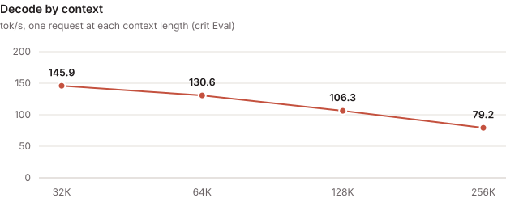
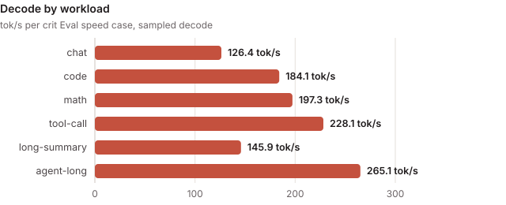

<!-- Rendered by tools/card.py from card.yaml: edit card.yaml, then run python -B tools/card.py on this folder. -->

# mtp-adaptive-width

### rtx5090 · qwen3.8-27b@NVFP4

> [!NOTE]
> **Contributed by** crit-labs · [crit-labs/crit](https://github.com/crit-labs/crit)

| Decode (sampled) | Decode (greedy) | Prefill | TTFT | Perplexity | Mean KL divergence | Context |
| :---: | :---: | :---: | :---: | :---: | :---: | :---: |
| **185.3 tok/s** | **195.5 tok/s** | **3,580 tok/s** | **337 ms** | **+0.4% vs reference** | **0.022** | **262,144 tok** |

- **Measured with:** crit Eval (crit-eval-v0.2.1, decode sampled at the model's defaults) · [crit-eval.json](evidence/crit-eval.json)
- **Quality mode:** preserve: quality judged against the checkpoint's own arithmetic with exact activations, so the drift is what the engine adds; the worst path uses 57.3% of its quality budget
- **Hardware:** Ubuntu 24.04.4 LTS (WSL); AMD Ryzen 5 9600 6-Core Processor (6/12 cores); 82 GiB RAM; NVIDIA GeForce RTX 5090 32 GiB, PCIe 4.0 x16 (GPU supports 5.0)
- **Further figures:** long-context decode 112.5 tok/s · held-out decode 126.3 tok/s
- **Requires:** WSL2 · sm_120 · 32 GB GPU memory · CUDA 13.1 · crit Core Python engine, torch 2.14.1+cu130, Triton 3.8.0
- **Checkpoint** (`qwen3.8-27b@NVFP4`): [`unsloth/Qwen3.8-27B-NVFP4`](https://huggingface.co/unsloth/Qwen3.8-27B-NVFP4/tree/f0b7c9e722f5565102fff8481c99e4d86ae099c7) at `f0b7c9e7`
- **Source:** [crit-labs/crit-engines/mtp-adaptive-width @ `53e4423b`](https://github.com/crit-labs/crit-engines/tree/53e4423ba6f0704a0d8862e2c15add650edef6a9/mtp-adaptive-width)
- **Built:** 3.34 h · 5 candidates · 127.2M agent tokens · $36.81 API-equivalent · by Claude Code (Claude Opus 5.5)
- **License:** Apache-2.0

A Python engine on crit Core's engine interface, written from scratch in five candidates, that keeps the
checkpoint's own arithmetic: weights as stored, prompt activations in 16 bits except where quality showed
8 bits hold. Each decode round drafts with the model's own MTP layer and verifies in one pass, with
rejection sampling on the GPU; the draft width moves between 2 and 8 with the previous round's acceptance.
Judged in crit Eval's default `preserve` quality mode.

---

## Design

| Part | How |
| --- | --- |
| Engine | A Python engine behind crit_core.native's stock serve and Eval adapters: chat, streaming, tools, log-probabilities, scores and plain decoding on request |
| Weights | Used as stored (FP8 per-channel, NVFP4 E2M1 with E4M3 group scales). For drafting only, the MTP layer is re-encoded as FP8 per output channel. The embedding table sits in pinned host memory, gathered through its mapped device address |
| Decode | One CUDA graph per round with 2, 3, 4, 6 or 8 drafts: one more width step after a round that kept every draft, one fewer after one that kept fewer; the KV and drafter caches hold 16 positions past the context, so drafting stays on to its end |
| Sampling | Core's sampling law, log-probabilities and commit on the device: crit Inference's `token-sampling` (`native/sampling.cu`) behind a small C ABI |
| GEMVs | Its own Triton GEMVs on the stored FP8 and NVFP4 encodings (hardware E2M1 conversion, 91-95% of bandwidth), column invariant with a deterministic split along K |
| Prefill | 4,096-token chunks: 16-bit GEMMs over exactly widened NVFP4 weights, FP8 per-token activations on the gated-delta and FP8 MLP projections, flash-linear-attention's chunked gated delta rule, PyTorch's flash attention, a Triton convolution |

---

## Measured



crit Eval of sealed candidate-0005, six speed cases at the full context:

| Metric | Result |
| --- | ---: |
| Whole requests (end to end) | 118.3 tok/s |
| Long-context first token (32K to 262K; 147.1 s at 262K) | 36.5 s |
| Quality, worst path (4,096-token prompts) | 57% of the budget: KLD mean 0.022, p99 0.29 (budget: PPL ×1.05, KLD mean 0.05, p99 0.5) |

Sampled decode by case: chat 126, code 184, math 197, tool call 228, long summary 146, agent 265 tok/s,
4.5 tokens per round on average. A verify pass takes 15.7 ms against the 13.3 ms its weight reads need;
prefill runs at 77% of the ceiling Eval prices for 16-bit prompt activations.



---

## Checks

- **Functional:** every Eval gate passed: coverage, repeatable, request history, prompt cache, quality,
  sampling (1,208 tokens, z -1.29), capacity, retrieval at 4K to 262,144 tokens, lower context and
  generality, and exactness (6 of 6 cases equal plain greedy). `crit run serve --check` passed all nine
  serving cases, including a tool call, log-probabilities and cancel.
- **Resources:** at the full context 1.09 GB of VRAM stayed free after the context curve.

---

## Limits

- Needs the whole 32 GB GPU; `native/build.sh` builds for sm_120 with the toolkit at `/usr/local/cuda-13.1`.
- One sequence at a time; no prompt cache across requests.
- The result does not report per-round verify and draft times, and Eval reads every round against the
  widest draft width, so its drafter projections for this engine are approximate.
- Text only: the vision tower is not loaded.
- Tested only on WSL2 Ubuntu 24.04 with torch 2.14.1+cu130 and Triton 3.8.0.

---

## Build and chat

```sh
git clone https://github.com/crit-labs/crit-engines && git -C crit-engines checkout 53e4423ba6f0704a0d8862e2c15add650edef6a9
ENGINE=crit-engines/mtp-adaptive-width/engine
bash "$ENGINE/native/build.sh"
```

The build compiles `libq38sampling.so` with nvcc (set `NVCC` for another toolkit path). Run it in a Python
environment with crit installed, torch 2.14.1+cu130 and Triton 3.8.0; flash-linear-attention and einops are
vendored. Check the checkpoint from a crit-hub checkout with
`python -B tools/verify_model.py engines/crit-labs/mtp-adaptive-width /path/to/checkpoint`. Loading takes about 33 s.

To chat, register `engine/` as a crit run candidate following crit's
[Building engines](https://github.com/crit-labs/crit/blob/main/docs/BUILDING_ENGINES.md) and serve it with
[`crit serve`](https://github.com/crit-labs/crit/blob/main/docs/SERVING.md), which answers OpenAI-compatible
chat requests at `http://127.0.0.1:8000/v1`. `engine/configuration.json` has the applied settings, with
thinking off by default (`enable_thinking: false`).

---

## Credits

Credits and licenses are in [THIRD_PARTY.md](https://github.com/crit-labs/crit-engines/blob/53e4423ba6f0704a0d8862e2c15add650edef6a9/mtp-adaptive-width/THIRD_PARTY.md)
and [LICENSES.txt](https://github.com/crit-labs/crit-engines/blob/53e4423ba6f0704a0d8862e2c15add650edef6a9/mtp-adaptive-width/LICENSES.txt), next to
the source.
