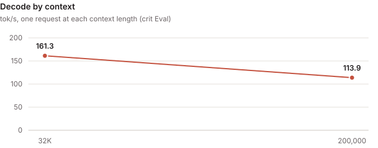
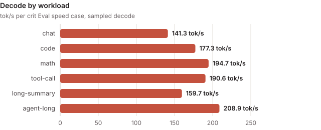

<!-- Rendered by tools/card.py from card.yaml: edit card.yaml, then run python -B tools/card.py on this folder. -->

# mtp3-exact-prompt-rows

### rtx5090 · qwen3.8-27b@NVFP4

> [!NOTE]
> **Contributed by** [crit-labs](https://github.com/crit-labs)

| Quality mode | Decode (sampled) | Decode (greedy) | Prefill | TTFT | Perplexity | Mean KL divergence | Context |
| :---: | :---: | :---: | :---: | :---: | :---: | :---: | :---: |
| preserve | **177.2 tok/s** | **186.7 tok/s** | **2,371 tok/s** | **423 ms** | **+0.6% vs reference** | **0.018** | **200,000 tok** |

- **Measured with:** crit Eval (crit-eval-v0.6.0, decode sampled at the model's defaults) · [crit-eval.json](evidence/crit-eval.json)
- **Track:** open: any choice the protocol allows (a budget of its own, drafter, settings per case)
- **Quality mode:** preserve: drift from the checkpoint the user selected judged by a budget that keeps the output close to the checkpoint's; the worst path uses 36.8% of its quality budget
- **Hardware:** Ubuntu 24.04.4 LTS (WSL); AMD Ryzen 5 9600 6-Core Processor (6/12 cores); 82 GiB RAM; NVIDIA GeForce RTX 5090 32 GiB, PCIe 4.0 x16 (GPU supports 5.0)
- **Further figures:** long-context decode 135.5 tok/s · held-out decode 134.0 tok/s
- **Throughput:** 128.7 tok/s at concurrency 1 · 223.3 tok/s at concurrency 2 · 309.6 tok/s at concurrency 4 (aggregate of the concurrent requests; crit Eval)
- **Requires:** WSL2 · sm_120a · 32 GB GPU memory · CUDA 13.1 · crit Core plugin package, torch 2.14.1+cu130, Triton 3.8.0
- **Checkpoint** (`qwen3.8-27b@NVFP4`): [`unsloth/Qwen3.8-27B-NVFP4`](https://huggingface.co/unsloth/Qwen3.8-27B-NVFP4/tree/f0b7c9e722f5565102fff8481c99e4d86ae099c7) at `f0b7c9e7`
- **Source:** [crit-labs/crit-engines/mtp3-exact-prompt-rows @ `dc41ff0d`](https://github.com/crit-labs/crit-engines/tree/dc41ff0d8f6f2dcbcf54fc87ede71232cc42046e/mtp3-exact-prompt-rows)
- **Built:** 3.73 h · 5 candidates · 108.3M agent tokens · $29.99 API-equivalent · by Claude Code (Claude Opus 5.5)
- **License:** Apache-2.0

- A plugin package on crit Core, built in five candidates: crit's library plugins plus its own model plugin for Qwen3.8's hybrid layout (48 gated-delta and 16 gated-attention layers), which crit's library did not have
- Runs Qwen3.8-27B from its NVFP4 and FP8 weights as stored, with 16-bit activations everywhere, judged in crit Eval's `preserve` quality mode
- Prompt rows run on the decode kernels' 16-bit arithmetic, so a served reply scores exactly as the same text scored as a prompt
- Drafts 3 tokens a round with the checkpoint's own MTP layer in Core's native captured rounds, from FP8 copies of its matrices and an NVFP4 copy of the output head in 8 row slices
- 200,000 tokens of context on the 32 GB GPU, FP8 KV pages

---

## Design

| Slot | Plugin and settings |
| --- | --- |
| Model | `qwen35-model` (this engine's own): matrices stacked by input (q, k and v; qkv and z; b and a; gate and up), the MTP layer as the device draft head with its prompt KV written during prefill, captured prompt chunks of 32 to 512 tokens, cached memory released after long prompts and scores, kernel tuning tables shipped in `tuning/` |
| Projections | `quantized-projections`: the stored NVFP4 and FP8 matrices with BF16 activations (W4A16, W8A16) through crit's mma-rows prompt and decode tiles; draft-only FP8 MTP matrices and an NVFP4 head copy |
| KV cache and attention | `attention-state`: FP8 pages with the checkpoint's static scales, FP8 pages for the MTP layer; `softmax-attention` with the decode-order prompt reader |
| Recurrence | `sequential-recurrence`: the exact recurrent scan, also for prompt chunks of 512 tokens |
| Drafting | `greedy-head-drafter`, width 3, verified in Core's native rounds; `token-sampling` for greedy and sampled rounds |
| Other | `fused-norms`, `memory-table-rows` (embedding rows in registered host memory), `device-placement`, page-reserving admission |

---

## Measured



| Measurement | Value |
| :--- | ---: |
| Decode, sampled (temperature 1.0, top-p 0.95, top-k 20) | 177.2 tok/s |
| Decode, greedy | 186.7 tok/s |
| Tokens per decode round, sampled | 3.3 |
| Prefill | 2,371 tok/s, 24% of its ceiling |
| Time to first token | 423 ms |
| Whole requests, end to end | 105.2 tok/s |
| Held-out prompts, decode | 134.0 tok/s |
| Long context, decode | 135.5 tok/s |
| Long context, first token | 56.7 s |
| Follow-up turn, first token | 3.5 s |
| Perplexity vs reference, worst path | +0.6% (long-32768/served) |
| KL divergence, worst path | mean 0.018, p99 0.18 (long-4096/prompt) |
| Top-1 agreement, lowest | 97.7% (long-4096/prompt) |
| Quality budget used | 37% (long-4096/prompt) |
| Quality budget | PPL ×1.05, KLD mean 0.05, p99 0.5 |
| Verify pass | 44.0 ms, against 13.8 ms of reads (31%) |
| Context | 200,000 tokens |
| VRAM free at the full context | 1.75 GB |
| Load time | 42.1 s |

| Speed case | Prompt tokens | Decode, sampled | Decode, greedy | Tokens per round | First token |
| :--- | ---: | ---: | ---: | ---: | ---: |
| chat | 87 | 141.3 tok/s | 136.5 tok/s | 2.6 | 82 ms |
| code | 97 | 177.3 tok/s | 193.4 tok/s | 3.3 | 82 ms |
| math | 213 | 194.7 tok/s | 198.6 tok/s | 3.6 | 116 ms |
| tool-call | 2,052 | 190.6 tok/s | 218.6 tok/s | 3.6 | 867 ms |
| long-summary | 3,584 | 159.7 tok/s | 173.9 tok/s | 3.0 | 1.5 s |
| agent-long | 14,336 | 208.9 tok/s | 212.6 tok/s | 4.0 | 6.3 s |

| Context | Decode | First token | Prefill | Tokens per round |
| :--- | ---: | ---: | ---: | ---: |
| 32,768 | 161.3 tok/s | 15.7 s | 2,031 tok/s | 3.2 |
| 200,000 | 113.9 tok/s | 204.9 s | 974.7 tok/s | 3.0 |

- crit Eval (crit-eval-v0.6.0) of sealed candidate-0005, certified, at 200,000 tokens of context
- Prefill is bound by `preserve`'s honesty rule: prompt rows must sum like decode rows, so they stay on the 16-bit decode tile, the exact recurrent scan and decode-order attention; it reaches 47% of the 5,018 tok/s that arithmetic allows
- Decode reaches 74% of the 238.6 tok/s ceiling crit computes with the draft step's cost left out
- Plain decoding without the drafter runs at about 67 tok/s against a 72.9 tok/s single-pass floor
- Greedy drafted output is token for token what plain greedy decoding produces



---

## Checks

- **Gates:** every gate of the certified Eval passed: coverage, repeatable, request history, prompt cache, quality (36.8% of the `preserve` budget, worst mean KL divergence 0.018 on 4,096-token prompts), sampling, capacity at 200,000 tokens, retrieval, lower context, concurrency and generality
- **Honesty:** served replies score exactly as the same text scored (difference 0.0)
- **Functional:** `crit run serve --check` passed the plugin tests, the serving checks, crit smoke at 200,000 tokens and at a quarter of it, and Eval's pre-check; the model plugin's tests compare scores, greedy choices, batching, honesty and drafting against transformers' Qwen3_5ForCausalLM on a small random checkpoint with a random MTP layer
- **Resources:** 1.75 GB of device memory stayed free after the 200,000-token curve
- **Track:** open: the engine declares no `draft_bytes_per_step`, so Eval could not compare its draft step with the checkpoint's draft layers

---

## Limits

- A prompt that fills 200,000 tokens gets its first token after 205 s
- Plain and replayed requests decode through eager `step()` at 44 ms a pass, against a 13.8 ms floor
- Follow-up turns reuse no prompt cache: an 8,192-token turn pays 3.4 s each time
- Core's native rounds leave 1.4 ms of host time between rounds (a 16.98 ms graph in an 18.41 ms round)
- Switching candidates under `crit serve` was not verified in the build
- Tested only on WSL2 Ubuntu 24.04 with torch 2.14.1+cu130, Triton 3.8.0 and the CUDA 13.1 toolkit, on one RTX 5090

---

## Build and chat

```sh
git clone https://github.com/crit-labs/crit-engines && git -C crit-engines checkout dc41ff0d8f6f2dcbcf54fc87ede71232cc42046e
crit pull crit-labs/mtp3-exact-prompt-rows
crit serve --engine crit-labs/mtp3-exact-prompt-rows
```

- `engine/` is a plugin package: crit's plugin loader assembles it from `engine/configuration.json`, and crit's kernels compile at load with the tuning tables in `engine/plugins/qwen35-model/tuning/`
- Needs a Python environment with crit installed, torch 2.14.1+cu130 and Triton 3.8.0
- Check the checkpoint from a crit-hub checkout: `python -B tools/verify_model.py engines/crit-labs/mtp3-exact-prompt-rows /path/to/checkpoint`
- Chat at `http://127.0.0.1:8000/v1` (OpenAI-compatible); thinking is off by default (`enable_thinking: false`)

---

## Benchmark your machine

```sh
crit pull crit-labs/mtp3-exact-prompt-rows
crit bench crit-labs/mtp3-exact-prompt-rows --data <a folder for crit Eval's data> --out result.json
crit hub report crit-labs/mtp3-exact-prompt-rows result.json --hub <your crit-hub checkout> --by <your GitHub account>
```

- `crit bench` prepares crit Eval's data from the checkpoint `crit pull` installed, runs its speed suite (and quality
  where the data holds the reference's scores) and prints this card's stats beside yours
- `crit hub report` adds your result file under `evidence/` and to this card, as a reproduction of the GPU and model
  it measured or as a new result, for a pull request to crit-hub

---

## Credits

Credits and licenses are in [THIRD_PARTY.md](https://github.com/crit-labs/crit-engines/blob/dc41ff0d8f6f2dcbcf54fc87ede71232cc42046e/mtp3-exact-prompt-rows/THIRD_PARTY.md) and [LICENSES.txt](https://github.com/crit-labs/crit-engines/blob/dc41ff0d8f6f2dcbcf54fc87ede71232cc42046e/mtp3-exact-prompt-rows/LICENSES.txt), next to the source.
