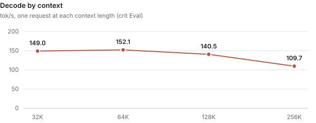
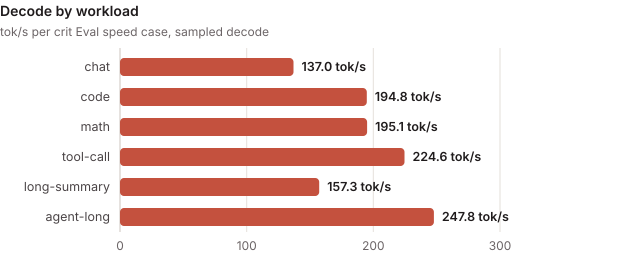

<!-- Rendered by tools/card.py from card.yaml: edit card.yaml, then run python -B tools/card.py on this folder. -->

# mtp4-nvfp4-mma

### rtx5090 · qwen3.8-27b@NVFP4

> [!NOTE]
> **Contributed by** [crit-labs](https://github.com/crit-labs)

| Decode (sampled) | Decode (greedy) | Prefill | TTFT | Perplexity | Mean KL divergence | Context |
| :---: | :---: | :---: | :---: | :---: | :---: | :---: |
| **189.0 tok/s** | **194.3 tok/s** | **8,295 tok/s** | **154 ms** | **+3.6% vs reference** | **0.13** | **262,144 tok** |

- **Measured with:** crit Eval (crit-eval-v0.2.1, decode sampled at the model's defaults) · [crit-eval.json](evidence/crit-eval.json)
- **Track:** open: any choice the protocol allows (a budget of its own, drafter, settings per case)
- **Quality mode:** speed: drift from the checkpoint the user selected traded for speed, judged by a wider budget of its own that only keeps out a broken engine, whatever format the checkpoint is stored in; the worst path uses 70.1% of its quality budget
- **Hardware:** Ubuntu 24.04.4 LTS (WSL); AMD Ryzen 5 9600 6-Core Processor (6/12 cores); 82 GiB RAM; NVIDIA GeForce RTX 5090 32 GiB, PCIe 4.0 x16 (GPU supports 5.0)
- **Further figures:** long-context decode 136.7 tok/s · held-out decode 131.2 tok/s
- **Requires:** WSL2 · sm_120a · 32 GB GPU memory · CUDA 13.1 · crit Core Python engine, torch 2.14.1+cu130, Triton 3.8.0
- **Checkpoint** (`qwen3.8-27b@NVFP4`): [`unsloth/Qwen3.8-27B-NVFP4`](https://huggingface.co/unsloth/Qwen3.8-27B-NVFP4/tree/f0b7c9e722f5565102fff8481c99e4d86ae099c7) at `f0b7c9e7`
- **Source:** [crit-labs/crit-engines/mtp4-nvfp4-mma @ `53e4423b`](https://github.com/crit-labs/crit-engines/tree/53e4423ba6f0704a0d8862e2c15add650edef6a9/mtp4-nvfp4-mma)
- **Built:** 3.91 h · 5 candidates · 149.3M agent tokens · $50.75 API-equivalent · by Claude Code (Claude Opus 5.5)
- **License:** Apache-2.0

- A Python engine on crit Core's engine interface, written from scratch in five candidates
- Runs the checkpoint the way it was quantized: NVFP4 and FP8 weights as stored, NVFP4 activations for the prompt's NVFP4 matrices
- Each decode round drafts 4 tokens with the model's own MTP layer and verifies them in one pass
- Rejection sampling on the GPU, so sampled requests draft too
- Judged in crit Eval's `speed` quality mode

---

## Design

| Part | How |
| --- | --- |
| Engine | A Python engine behind crit_core.native's stock serve and Eval adapters: chat, streaming, tools, log-probabilities, scores and plain decoding on request |
| Weights | Used as stored: FP8 per-channel attention, gated-delta projections, MLPs 56-63 and output head; NVFP4 MLPs 0-55. For drafting only, the MTP layer and the output head are re-encoded as NVFP4 copies with per-row dynamic activation scales; the verify pass keeps the stored weights. The embedding table sits in pinned host memory |
| Decode | One CUDA graph per round: 4 draft steps, then a 5-column verify pass; the GPU decides how many drafts stand and keeps the recurrent state of the last standing column |
| GEMVs | Its own CUDA tensor-core NVFP4 GEMV (`qwen38/csrc/nvfp4_mma.cu`: the hardware E2M1 conversion into `mma.m16n8k16`, 1.2-1.4 TB/s against cuBLASLt's 0.9-1.0), Triton FP8 (1.3-1.6 TB/s) and bf16 GEMVs, one instruction stream for every column count |
| Prefill | 2,048-token chunks: cuBLASLt NVFP4 and tensor-wise FP8 GEMMs through `torch._scaled_mm`, flash-linear-attention's chunked gated delta rule, its own Triton attention over the FP8 cache; prompts up to 512 tokens run as captured graphs of 128- and 512-row buckets |
| Exactness | Greedy output equals plain greedy decoding token for token; padding rows and kernels never depend on the column count |

---

## Measured



| Measurement | Value |
| :--- | ---: |
| Decode, sampled (temperature 1.0, top-p 0.95, top-k 20) | 189.0 tok/s |
| Decode, greedy | 194.3 tok/s |
| Tokens per decode round, sampled | 3.8 |
| Prefill | 8,295 tok/s, 46% of its ceiling |
| Time to first token | 154 ms |
| Whole requests, end to end | 145.3 tok/s |
| Held-out prompts, decode | 131.2 tok/s |
| Long context, decode | 136.7 tok/s |
| Long context, first token | 26.0 s |
| Follow-up turn, first token | 1.0 s |
| Perplexity vs reference, worst path | +3.6% (long-32768/served) |
| KL divergence, worst path | mean 0.134, p99 2.22 (long-32768/prompt) |
| Top-1 agreement, lowest | 87.4% (long-4096/prompt) |
| Quality budget used | 70% (long-1024/prompt) |
| Quality budget | PPL ×1.1, KLD mean 0.1, p99 1.0 |
| Verify pass | 15.1 ms, against 12.5 ms of reads (83%) |
| Draft step | 1.24 ms, against 0.62 ms of reads |
| Context | 262,144 tokens |
| VRAM free at the full context | 1.24 GB |
| Load time | 15.1 s |

| Speed case | Prompt tokens | Decode, sampled | Decode, greedy | Tokens per round | First token |
| :--- | ---: | ---: | ---: | ---: | ---: |
| chat | 87 | 137.0 tok/s | 140.1 tok/s | 2.8 | 32 ms |
| code | 97 | 194.8 tok/s | 184.2 tok/s | 3.9 | 32 ms |
| math | 213 | 195.1 tok/s | 204.8 tok/s | 3.9 | 61 ms |
| tool-call | 2,052 | 224.6 tok/s | 249.2 tok/s | 4.4 | 296 ms |
| long-summary | 3,584 | 157.3 tok/s | 160.6 tok/s | 3.2 | 401 ms |
| agent-long | 14,336 | 247.8 tok/s | 254.3 tok/s | 4.9 | 1.9 s |

| Context | Decode | First token | Prefill | Tokens per round |
| :--- | ---: | ---: | ---: | ---: |
| 32,768 | 149.0 tok/s | 5.2 s | 6,229 tok/s | 3.4 |
| 65,536 | 152.1 tok/s | 14.1 s | 4,642 tok/s | 3.5 |
| 131,072 | 140.5 tok/s | 42.9 s | 3,048 tok/s | 3.6 |
| 262,144 | 109.7 tok/s | 144.5 s | 1,812 tok/s | 3.4 |

- crit Eval of sealed candidate-0005, six speed cases at the full context
- Prefill's ceiling is the GPU's measured compute ceiling
- The quality budget is raised per text to twice the reference's spread
- The long-context figures are the geometric mean of the context table's points



---

## Checks

- **Functional:** every Eval gate passed: coverage, repeatable, request history, prompt cache, quality,
  sampling (1,519 tokens, z -1.70), capacity, retrieval at 4K to 262,144 tokens, lower context and
  generality, and exactness (6 of 6 cases equal plain greedy). `crit run serve --check` passed consecutive
  requests, a system message, streaming, a stop string, cancel, a tool call, log-probabilities, a template
  switch and stop.
- **Resources:** at the full context 1.24 GB of VRAM stayed free after the context curve.

---

## Limits

- Needs the whole 32 GB GPU, and builds its CUDA GEMV for sm_120a only (`qwen38/csrc/build.py`).
- One sequence at a time; no prompt cache across requests.
- Sampling laws that do not close within 64 candidate tokens (top-k 0 or above 64) and plain requests
  decode one token per pass, at about 53 tok/s.
- Text only: the vision tower is not loaded.
- Tested only on WSL2 Ubuntu 24.04 with torch 2.14.1+cu130, Triton 3.8.0 and the CUDA 13.1 toolkit.

---

## Build and chat

```sh
git clone https://github.com/crit-labs/crit-engines && git -C crit-engines checkout 53e4423ba6f0704a0d8862e2c15add650edef6a9
ENGINE=crit-engines/mtp4-nvfp4-mma/engine
python "$ENGINE/qwen38/csrc/build.py"
```

- The build compiles the NVFP4 GEMV with `torch.utils.cpp_extension` into `qwen38/`
- Needs a Python environment with crit installed, torch 2.14.1+cu130, Triton 3.8.0 and the CUDA 13.1 toolkit; flash-linear-attention and einops are vendored
- Check the checkpoint from a crit-hub checkout: `python -B tools/verify_model.py engines/crit-labs/mtp4-nvfp4-mma /path/to/checkpoint`
- Loading takes about 15 s
- To chat, register `engine/` as a crit run candidate ([Building engines](https://github.com/crit-labs/crit/blob/main/docs/BUILDING_ENGINES.md)) and serve it
  with [`crit serve`](https://github.com/crit-labs/crit/blob/main/docs/SERVING.md): OpenAI-compatible chat requests at `http://127.0.0.1:8000/v1`
- `engine/configuration.json` has the applied settings; thinking is off by default (`enable_thinking: false`)

---

## Benchmark your machine

```sh
crit pull crit-labs/mtp4-nvfp4-mma
crit bench crit-labs/mtp4-nvfp4-mma --data <a folder for crit Eval's data> --out result.json
crit hub report crit-labs/mtp4-nvfp4-mma result.json --hub <your crit-hub checkout> --by <your GitHub account>
```

- `crit bench` prepares crit Eval's data from the checkpoint `crit pull` installed, runs its speed suite (and quality
  where the data holds the reference's scores) and prints this card's stats beside yours
- `crit hub report` adds your result file under `evidence/` and to this card, as a reproduction of the GPU and model
  it measured or as a new result, for a pull request to crit-hub

---

## Credits

Credits and licenses are in [THIRD_PARTY.md](https://github.com/crit-labs/crit-engines/blob/53e4423ba6f0704a0d8862e2c15add650edef6a9/mtp4-nvfp4-mma/THIRD_PARTY.md) and [LICENSES.txt](https://github.com/crit-labs/crit-engines/blob/53e4423ba6f0704a0d8862e2c15add650edef6a9/mtp4-nvfp4-mma/LICENSES.txt), next to the source.
