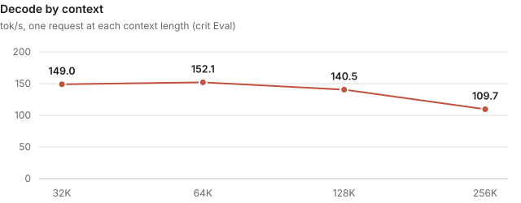
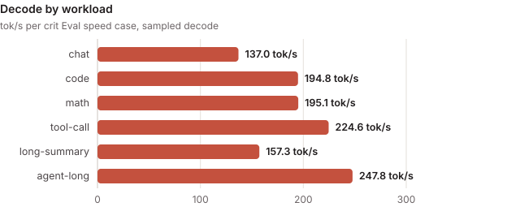

<!-- Rendered by tools/card.py from card.yaml: edit card.yaml, then run python -B tools/card.py on this folder. -->

# mtp4-nvfp4-mma

### rtx5090 · qwen3.8-27b@NVFP4

> [!NOTE]
> **Contributed by** crit-labs · [crit-labs/crit](https://github.com/crit-labs/crit)

| Decode (sampled) | Decode (greedy) | Prefill | TTFT | Perplexity | Mean KL divergence | Context |
| :---: | :---: | :---: | :---: | :---: | :---: | :---: |
| **189.0 tok/s** | **194.3 tok/s** | **8,295 tok/s** | **154 ms** | **+3.6% vs reference** | **0.13** | **262,144 tok** |

- **Measured with:** crit Eval (crit-eval-v0.2.1, decode sampled at the model's defaults) · [crit-eval.json](evidence/crit-eval.json)
- **Quality mode:** as quantized: quality judged against the checkpoint run as quantized, its activations quantized as it declares, with a drift budget of its own; the worst path uses 70.1% of its quality budget
- **Hardware:** Ubuntu 24.04.4 LTS (WSL); AMD Ryzen 5 9600 6-Core Processor (6/12 cores); 82 GiB RAM; NVIDIA GeForce RTX 5090 32 GiB, PCIe 4.0 x16 (GPU supports 5.0)
- **Further figures:** long-context decode 136.7 tok/s · held-out decode 131.2 tok/s
- **Requires:** WSL2 · sm_120a · 32 GB GPU memory · CUDA 13.1 · crit Core Python engine, torch 2.14.1+cu130, Triton 3.8.0
- **Checkpoint** (`qwen3.8-27b@NVFP4`): [`unsloth/Qwen3.8-27B-NVFP4`](https://huggingface.co/unsloth/Qwen3.8-27B-NVFP4/tree/f0b7c9e722f5565102fff8481c99e4d86ae099c7) at `f0b7c9e7`
- **Source:** [crit-labs/crit-engines/mtp4-nvfp4-mma @ `53e4423b`](https://github.com/crit-labs/crit-engines/tree/53e4423ba6f0704a0d8862e2c15add650edef6a9/mtp4-nvfp4-mma)
- **Built:** 3.91 h · 5 candidates · 149.3M agent tokens · $50.75 API-equivalent · by Claude Code (Claude Opus 5.5)
- **License:** Apache-2.0

A Python engine on crit Core's engine interface, written from scratch in five candidates, that runs the
checkpoint the way it was quantized: NVFP4 and FP8 weights as stored, NVFP4 activations for the prompt's
NVFP4 matrices. Each decode round drafts 4 tokens with the model's own MTP layer and verifies them in one
pass, with rejection sampling on the GPU, so sampled requests draft too. Judged in crit Eval's
`as_quantized` quality mode.

---

## Design

| Part | How |
| --- | --- |
| Engine | A Python engine behind crit_core.native's stock serve and Eval adapters: chat, streaming, tools, log-probabilities, scores and plain decoding on request |
| Weights | Used as stored: FP8 per-channel attention, gated-delta projections, MLPs 56-63 and output head; NVFP4 MLPs 0-55. For drafting only, the MTP layer and the output head are re-encoded as NVFP4 copies with per-row dynamic activation scales; the verify pass keeps the stored weights. The embedding table sits in pinned host memory |
| Decode | One CUDA graph per round: 4 draft steps, then a 5-column verify pass; the GPU decides how many drafts stand and keeps the recurrent state of the last standing column |
| GEMVs | Its own CUDA tensor-core NVFP4 GEMV (`qwen38/csrc/nvfp4_mma.cu`: the hardware E2M1 conversion into `mma.m16n8k16`, 1.2-1.4 TB/s against cuBLASLt's 0.9-1.0), Triton FP8 (1.3-1.6 TB/s) and bf16 GEMVs, one instruction stream for every column count |
| Prefill | 2,048-token chunks: cuBLASLt NVFP4 and tensor-wise FP8 GEMMs through `torch._scaled_mm`, flash-linear-attention's chunked gated delta rule, its own Triton attention over the FP8 cache; prompts up to 512 tokens run as captured graphs of 128- and 512-row buckets |
| Exactness | Greedy output equals plain greedy decoding token for token; padding rows and kernels never depend on the column count |

---

## Measured



crit Eval of sealed candidate-0005, six speed cases at the full context:

| Metric | Result |
| --- | ---: |
| Whole requests (end to end) | 145.3 tok/s |
| Long-context first token (32K to 262K; 144.5 s at 262K) | 26.0 s |
| Quality, worst path (1,024-token prompts) | 70% of the budget: KLD mean 0.069, p99 1.0 (budget: PPL ×1.1, KLD mean 0.1, p99 1.0, raised per text to twice the reference's spread) |

Sampled decode by case: chat 137, code 195, math 195, tool call 225, long summary 157, agent 248 tok/s,
3.8 tokens per round on average. A verify pass takes 15.1 ms against the 12.5 ms its weight reads need,
and a draft step 1.24 ms against 0.62 ms; prefill runs at 46% of the GPU's measured compute ceiling.



---

## Checks

- **Functional:** every Eval gate passed: coverage, repeatable, request history, prompt cache, quality,
  sampling (1,519 tokens, z -1.70), capacity, retrieval at 4K to 262,144 tokens, lower context and
  generality, and exactness (6 of 6 cases equal plain greedy). `crit run serve --check` passed consecutive
  requests, a system message, streaming, a stop string, cancel, a tool call, log-probabilities, a template
  switch and stop.
- **Resources:** at the full context 1.24 GB of VRAM stayed free after the context curve.

---

## Limits

- Needs the whole 32 GB GPU, and builds its CUDA GEMV for sm_120a only (`qwen38/csrc/build.py`).
- One sequence at a time; no prompt cache across requests.
- Sampling laws that do not close within 64 candidate tokens (top-k 0 or above 64) and plain requests
  decode one token per pass, at about 53 tok/s.
- Text only: the vision tower is not loaded.
- Tested only on WSL2 Ubuntu 24.04 with torch 2.14.1+cu130, Triton 3.8.0 and the CUDA 13.1 toolkit.

---

## Build and chat

```sh
git clone https://github.com/crit-labs/crit-engines && git -C crit-engines checkout 53e4423ba6f0704a0d8862e2c15add650edef6a9
ENGINE=crit-engines/mtp4-nvfp4-mma/engine
python "$ENGINE/qwen38/csrc/build.py"
```

The build compiles the NVFP4 GEMV with `torch.utils.cpp_extension` into `qwen38/`; it needs a Python
environment with crit installed, torch 2.14.1+cu130, Triton 3.8.0 and the CUDA 13.1 toolkit.
flash-linear-attention and einops are vendored. Check the checkpoint from a crit-hub checkout with
`python -B tools/verify_model.py engines/crit-labs/mtp4-nvfp4-mma /path/to/checkpoint`. Loading takes about 15 s.

To chat, register `engine/` as a crit run candidate following crit's
[Building engines](https://github.com/crit-labs/crit/blob/main/docs/BUILDING_ENGINES.md) and serve it with
[`crit serve`](https://github.com/crit-labs/crit/blob/main/docs/SERVING.md), which answers OpenAI-compatible
chat requests at `http://127.0.0.1:8000/v1`. `engine/configuration.json` has the applied settings, with
thinking off by default (`enable_thinking: false`).

---

## Credits

Credits and licenses are in [THIRD_PARTY.md](https://github.com/crit-labs/crit-engines/blob/53e4423ba6f0704a0d8862e2c15add650edef6a9/mtp4-nvfp4-mma/THIRD_PARTY.md)
and [LICENSES.txt](https://github.com/crit-labs/crit-engines/blob/53e4423ba6f0704a0d8862e2c15add650edef6a9/mtp4-nvfp4-mma/LICENSES.txt), next to
the source.
