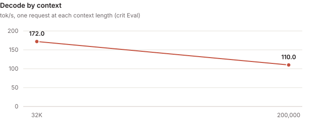
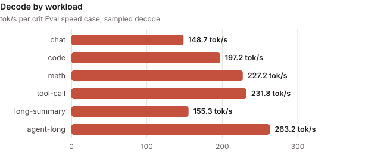

<!-- Rendered by tools/card.py from card.yaml: edit card.yaml, then run python -B tools/card.py on this folder. -->

# mtp5-nvfp4-drafts

### rtx5090 · qwen3.8-27b@NVFP4

> [!NOTE]
> **Contributed by** [crit-labs](https://github.com/crit-labs)

| Quality mode | Decode (sampled) | Decode (greedy) | Prefill | TTFT | Perplexity | Mean KL divergence | Context |
| :---: | :---: | :---: | :---: | :---: | :---: | :---: | :---: |
| speed | **199.5 tok/s** | **219.7 tok/s** | **7,552 tok/s** | **204 ms** | **+0.8% vs reference** | **0.087** | **200,000 tok** |

- **Measured with:** crit Eval (crit-eval-v0.6.0, decode sampled at the model's defaults) · [crit-eval.json](evidence/crit-eval.json)
- **Track:** closed: either quality mode at its protocol budget, one configuration for every workload, and the checkpoint's own draft layers as its only drafter
- **Quality mode:** speed: drift from the checkpoint the user selected traded for speed, judged by a wider budget of its own that only keeps out a broken engine, whatever format the checkpoint is stored in; the worst path uses 44.0% of its quality budget
- **Hardware:** Ubuntu 24.04.4 LTS (WSL); AMD Ryzen 5 9600 6-Core Processor (6/12 cores); 82 GiB RAM; NVIDIA GeForce RTX 5090 32 GiB, PCIe 4.0 x16 (GPU supports 5.0)
- **Further figures:** long-context decode 137.5 tok/s · held-out decode 134.9 tok/s
- **Throughput:** 147.7 tok/s at concurrency 1 · 235.8 tok/s at concurrency 2 · 250.1 tok/s at concurrency 4 (aggregate of the concurrent requests; crit Eval)
- **Requires:** WSL2 · sm_120a · 32 GB GPU memory · CUDA 13.1 · crit Core plugin package, torch 2.14.1+cu130, Triton 3.8.0
- **Checkpoint** (`qwen3.8-27b@NVFP4`): [`unsloth/Qwen3.8-27B-NVFP4`](https://huggingface.co/unsloth/Qwen3.8-27B-NVFP4/tree/f0b7c9e722f5565102fff8481c99e4d86ae099c7) at `f0b7c9e7`
- **Source:** [crit-labs/crit-engines/mtp5-nvfp4-drafts @ `5d488443`](https://github.com/crit-labs/crit-engines/tree/5d488443c654f521df8d3235eab228ae7fd75088/mtp5-nvfp4-drafts)
- **Built:** 5.46 h · 9 candidates · 93.9M agent tokens · $33.98 API-equivalent · by Claude Code (Claude Opus 5.5)
- **License:** Apache-2.0

- A plugin package on crit Core, built on five candidate rungs (nine sealed candidates): crit's library plugins plus its own model plugin for Qwen3.8's hybrid layout (48 gated-delta and 16 gated-attention layers), which crit's library did not have
- Runs Qwen3.8-27B from its NVFP4 and FP8 weights as stored, judged in crit Eval's `speed` quality mode
- Drafts 5 tokens a round with the checkpoint's own MTP layer inside Core's captured rounds, from NVFP4 copies of that layer and of the output head that only the drafter reads
- Sampled requests draft too: the verify pass samples with rejection sampling on the GPU
- 200,000 tokens of context on the 32 GB GPU, FP8 KV pages

---

## Design

| Slot | Plugin and settings |
| --- | --- |
| Model | `qwen35-model` (this engine's own): step, score and verify for the hybrid layout, the MTP layer as the device draft head, prompt chunks of 16 rows or fewer padded so a prompt row's bits never depend on the prompt's length |
| Projections | `quantized-projections`: the stored NVFP4 (W4A4) and FP8 matrices; prompt GEMMs on crit's pinned-gemm kernel, decode rows on mma-rows and decode-gemv; draft-only NVFP4 re-encodings of the MTP layer and of an output-head copy |
| KV cache and attention | `attention-state`: FP8 pages with the checkpoint's static scales, the MTP layer as an extra pool layer, window 6; `softmax-attention`: split-KV reader |
| Recurrence | `sequential-recurrence` on crit's recurrent-scans kernels: the exact scan for decode and verify rows, tensor-core chunked scans for prompt rows (`exact_rows: 0`) |
| Drafting | `greedy-head-drafter` and `chain-verifier`, width 5; `token-sampling` for rejection sampling in Core's native sampler |
| Other | `fused-norms` (+14% decode in the build's ablation), `memory-table-rows` (embedding table in host memory), `device-placement` |
| Prefill | 2,048-token chunks; short prompts run from Core's captured prompt graphs (buckets of 16, 64, 128 and 512 tokens) |

---

## Measured



| Measurement | Value |
| :--- | ---: |
| Decode, sampled (temperature 1.0, top-p 0.95, top-k 20) | 199.5 tok/s |
| Decode, greedy | 219.7 tok/s |
| Tokens per decode round, sampled | 4.1 |
| Prefill | 7,552 tok/s, 43% of its ceiling |
| Time to first token | 204 ms |
| Whole requests, end to end | 149.7 tok/s |
| Held-out prompts, decode | 134.9 tok/s |
| Long context, decode | 137.5 tok/s |
| Long context, first token | 21.6 s |
| Follow-up turn, first token | 1.1 s |
| Perplexity vs reference, worst path | +0.8% (long-4096/served) |
| KL divergence, worst path | mean 0.087, p99 1.76 (long-4096/prompt) |
| Top-1 agreement, lowest | 92.8% (long-4096/prompt) |
| Quality budget used | 44% (long-4096/prompt) |
| Quality budget | PPL ×1.4, KLD mean 0.4, p99 4.0 |
| Verify pass | 42.9 ms, against 13.8 ms of reads (32%) |
| Draft step | 0.00 ms, against 1.12 ms of reads |
| Context | 200,000 tokens |
| VRAM free at the full context | 0.56 GB |
| Load time | 29.9 s |

| Speed case | Prompt tokens | Decode, sampled | Decode, greedy | Tokens per round | First token |
| :--- | ---: | ---: | ---: | ---: | ---: |
| chat | 87 | 148.7 tok/s | 149.2 tok/s | 3.0 | 54 ms |
| code | 97 | 197.2 tok/s | 183.7 tok/s | 4.0 | 54 ms |
| math | 213 | 227.2 tok/s | 228.7 tok/s | 4.7 | 95 ms |
| tool-call | 2,052 | 231.8 tok/s | 296.7 tok/s | 4.8 | 286 ms |
| long-summary | 3,584 | 155.3 tok/s | 205.2 tok/s | 3.2 | 445 ms |
| agent-long | 14,336 | 263.2 tok/s | 294.9 tok/s | 5.6 | 2.0 s |

| Context | Decode | First token | Prefill | Tokens per round |
| :--- | ---: | ---: | ---: | ---: |
| 32,768 | 172.0 tok/s | 4.7 s | 5,982 tok/s | 3.8 |
| 200,000 | 110.0 tok/s | 100.3 s | 1,992 tok/s | 3.4 |

- crit Eval (crit-eval-v0.6.0) of sealed candidate-0009, certified, at 200,000 tokens of context
- Eval measured with kernel tuning tables from `crit kernels sweep` for this model (`CRIT_KERNEL_TUNING`); the package does not carry them, so it builds crit's default knobs, which measured the same in process
- Decode reaches 65% of the 305 tok/s ceiling Eval prices for it; prefill 43% of its 17,577 tok/s
- Four clients together reach 250 tok/s: each row runs its full 5-token draft chain
- Greedy drafted output is token for token what plain greedy decoding produces



---

## Checks

- **Gates:** every gate of the certified Eval passed: coverage, repeatable, request history, prompt cache, quality (44% of the `speed` budget, worst mean KL divergence 0.087), sampling, capacity at 200,000 tokens, retrieval, lower context, concurrency and generality
- **Functional:** `crit run serve --check` passed the plugin tests, the serving checks, crit smoke at 200,000 and 49,152 tokens and Eval's pre-check; the model plugin's tests compare scores, greedy choices, batching and drafting against transformers on a small random checkpoint
- **Resources:** 0.56 GB of device memory stayed free at 200,000 tokens after the long-context curve
- **Switching:** a served A to B to A candidate switch returned identical greedy replies

---

## Limits

- The NVFP4 prompt GEMMs run at about 40% of the GPU's FP4 rate on every GEMM structure crit offers
- A verify pass at width 5 takes 42.9 ms against a 13.8 ms floor
- A prompt that fills 200,000 tokens gets its first token after 100 s, against a 26 s floor
- Plain, replayed and constrained requests decode one token a step through `step()`, outside the captured rounds
- Kernel tuning is not part of the package (see Measured)
- Tested only on WSL2 Ubuntu 24.04 with torch 2.14.1+cu130, Triton 3.8.0 and the CUDA 13.1 toolkit, on one RTX 5090

---

## Build and chat

```sh
git clone https://github.com/crit-labs/crit-engines && git -C crit-engines checkout 5d488443c654f521df8d3235eab228ae7fd75088
crit pull crit-labs/mtp5-nvfp4-drafts
crit serve --engine crit-labs/mtp5-nvfp4-drafts
```

- `engine/` is a plugin package: crit's plugin loader assembles it from `engine/configuration.json`, and crit's kernels compile at load
- Needs a Python environment with crit installed, torch 2.14.1+cu130 and Triton 3.8.0
- Check the checkpoint from a crit-hub checkout: `python -B tools/verify_model.py engines/crit-labs/mtp5-nvfp4-drafts /path/to/checkpoint`
- Chat at `http://127.0.0.1:8000/v1` (OpenAI-compatible); thinking is off by default (`enable_thinking: false`)

---

## Benchmark your machine

```sh
crit pull crit-labs/mtp5-nvfp4-drafts
crit bench crit-labs/mtp5-nvfp4-drafts --data <a folder for crit Eval's data> --out result.json
crit hub report crit-labs/mtp5-nvfp4-drafts result.json --hub <your crit-hub checkout> --by <your GitHub account>
```

- `crit bench` prepares crit Eval's data from the checkpoint `crit pull` installed, runs its speed suite (and quality
  where the data holds the reference's scores) and prints this card's stats beside yours
- `crit hub report` adds your result file under `evidence/` and to this card, as a reproduction of the GPU and model
  it measured or as a new result, for a pull request to crit-hub

---

## Credits

Credits and licenses are in [THIRD_PARTY.md](https://github.com/crit-labs/crit-engines/blob/5d488443c654f521df8d3235eab228ae7fd75088/mtp5-nvfp4-drafts/THIRD_PARTY.md) and [LICENSES.txt](https://github.com/crit-labs/crit-engines/blob/5d488443c654f521df8d3235eab228ae7fd75088/mtp5-nvfp4-drafts/LICENSES.txt), next to the source.
