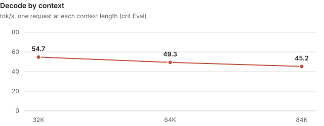
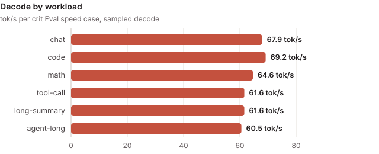

<!-- Rendered by tools/card.py from card.yaml: edit card.yaml, then run python -B tools/card.py on this folder. -->

# nvfp4-gemv-int8kv

### rtx5090 · nanbeige4.3-33b@NVFP4

> [!NOTE]
> **Contributed by** crit-labs · [crit-labs/crit](https://github.com/crit-labs/crit)

| Decode (sampled) | Decode (greedy) | Prefill | TTFT | Perplexity | Mean KL divergence | Context |
| :---: | :---: | :---: | :---: | :---: | :---: | :---: |
| **64.2 tok/s** | **66.6 tok/s** | **3,357 tok/s** | **404 ms** | **+0.5% vs reference** | **0.019** | **86,016 tok** |

- **Measured with:** crit Eval (crit-eval-v0.2.1, decode sampled at temperature 1.0: the protocol default) · [crit-eval.json](evidence/crit-eval.json)
- **Quality mode:** preserve: quality judged against the checkpoint's own arithmetic with exact activations, so the drift is what the engine adds; the worst path uses 67.3% of its quality budget
- **Hardware:** Ubuntu 24.04.4 LTS (WSL); AMD Ryzen 5 9600 6-Core Processor (6/12 cores); 82 GiB RAM; NVIDIA GeForce RTX 5090 32 GiB, PCIe 4.0 x16 (GPU supports 5.0)
- **Further figures:** long-context decode 49.6 tok/s · held-out decode 65.3 tok/s
- **Requires:** WSL2 · sm_120a · 32 GB GPU memory · CUDA 13.1 · crit Core Python engine, torch 2.14.1+cu130, Triton 3.8.0
- **Checkpoint** (`nanbeige4.3-33b@NVFP4`): [`webbrain-one/Nanbeige4.3-33B-NVFP4`](https://huggingface.co/webbrain-one/Nanbeige4.3-33B-NVFP4/tree/db25813ac527ade6a8b67e00a46135bc90617841) at `db25813a`
- **Source:** [crit-labs/crit-engines/nvfp4-gemv-int8kv @ `23810f34`](https://github.com/crit-labs/crit-engines/tree/23810f3444f720f12742ee177ccca18178382c35/nvfp4-gemv-int8kv)
- **Built:** 4.74 h · 6 candidates · 128.1M agent tokens · $36.11 API-equivalent · by Claude Code (Claude Opus 5.5)
- **License:** Apache-2.0

A Python engine on crit Core's engine interface, written in six candidates, that runs
Nanbeige4.3-33B, a dense 52-layer Llama, from its NVFP4 weights as stored. Decode is one token per pass,
one CUDA graph per step, on its own CUDA NVFP4 GEMV; the KV cache is INT8 with a scale per position and KV
head, which fits 86,016 tokens of context on the 32 GB GPU. Judged in crit Eval's default `preserve`
quality mode.

---

## Design

| Part | How |
| --- | --- |
| Engine | A Python engine behind crit_core.native's stock serve and Eval adapters: chat, streaming, tools, log-probabilities and scores |
| Weights | Used as stored: NVFP4 E2M1 codes with E4M3 group scales, the global scale folded into a per-row factor; BF16 output head |
| Decode | One CUDA graph per token: 52 layers, the output head and the greedy or temperature selection on the device. Its own CUDA NVFP4 GEMV (`nvfp4_gemv.cu`: the hardware E2M1 conversion `cvt.rn.f16x2.e2m1x2`, 1.49 TB/s against its Triton GEMV's 1.27), split-K attention over the INT8 cache |
| KV cache | INT8 per token and KV head with an FP32 scale (an FP8 E4M3 cache used 114% of the quality budget on 32K-token prompts) |
| Prefill | 2,048-token chunks. Attention and down projections: NVFP4 decoded to FP16 per chunk, cuBLAS with FP16 accumulation; gate and up projections: FP8 weights and per-row FP8 activations through `torch._scaled_mm`. INT8 Q.K^T prompt attention on tensor cores; prompts of up to 64 tokens multiply the stored codes directly |

---

## Measured



crit Eval of sealed candidate-0006, six speed cases at the required context of 86,016 tokens (the
largest whose KV cache fits the device):

| Metric | Result |
| --- | ---: |
| Whole requests (end to end) | 52.7 tok/s |
| Long-context first token (32K to 86K; 51.7 s at 86K) | 28.3 s |
| Quality, worst path (32,768-token prompts) | 67% of the budget: KLD mean 0.019, p99 0.34 (budget: PPL ×1.05, KLD mean 0.05, p99 0.5) |

Sampled decode by case: chat 68, code 69, math 65, tool call 62, long summary 62, agent 61 tok/s, one
token per pass. A step takes 15.1 ms against the 13.7 ms its weight and cache reads need (90% of the
one-token-per-pass ceiling of 71.7 tok/s). Prefill shows 116% of the ceiling Eval prices for 16-bit
prompt activations: Eval's device probe had no rate for FP16-accumulating GEMMs, so it cannot price the
mix this engine runs.



---

## Checks

- **Eval attempts:** two Eval runs of the same sealed package. The first (attempt-0002) failed the
  lower-context gate: at 21,504 tokens the tool-call and long-summary cases decoded 9.2% and 8.7% slower
  than at 86,016 (tolerance 5%), and their first tokens came 7.7% and 6.8% later. The build run read
  this as a transient device disturbance, since nothing in the engine changes with the context it is
  opened with, and ran Eval again on the same package. The second run (attempt-0003, the evidence here)
  passed every gate, with no case more than 5% slower at 21,504 tokens; its headline figures differ from
  the first run's by under 2%. The cause of the first failure was not proven. Both results stay in the
  sealed run; crit-hub takes only results whose gates all pass.
- **Functional:** every gate of attempt-0003 passed: coverage, repeatable, request history, prompt cache,
  quality, sampling (1,536 tokens, z -0.52), capacity, retrieval at 4K to 86,016 tokens, lower context
  and generality. `crit run serve --check` passed all nine serving cases, including a tool call,
  log-probabilities and cancel.
- **Resources:** at least 1.72 GB of VRAM stayed free at the full context, the least right after load.

---

## Limits

- Context is 86,016 tokens, not the model's 524,288: the INT8 KV cache for more does not fit the 32 GB GPU.
- No speculative decoding: the model has no MTP layer. `engine/drafter.py` holds a DFlash2 drafter
  (ported from SGLang) that loads only with a `draft_model` setting; it did not pay at temperature 1 and
  leaves almost no memory free at 86K, so the measured configuration does not load it.
- Requests with top-k, top-p or min-p filter the full vocabulary after the graph step, outside it; Eval
  measured only temperature sampling.
- One sequence at a time; no prompt cache across requests.
- `nvfp4_gemv.cu` builds for sm_120a only. The module docstring of `engine.py` still describes the first
  candidate (FP8 KV cache, Triton GEMV); `configuration.json` and this README describe what runs.
- Tested only on WSL2 Ubuntu 24.04 with torch 2.14.1+cu130, Triton 3.8.0 and the CUDA 13.1 toolkit.

---

## Build and chat

```sh
git clone https://github.com/crit-labs/crit-engines && git -C crit-engines checkout 23810f3444f720f12742ee177ccca18178382c35
cd crit-engines/nvfp4-gemv-int8kv/engine
nvcc -O3 -gencode arch=compute_120a,code=sm_120a -shared -Xcompiler -fPIC -cudart shared \
  -o libnvfp4_gemv.so nvfp4_gemv.cu
```

`kernels.py` loads `libnvfp4_gemv.so` from its own folder. Run it in a Python environment with crit
installed, torch 2.14.1+cu130 and Triton 3.8.0. Check the checkpoint from a crit-hub checkout with
`python -B tools/verify_model.py engines/crit-labs/nvfp4-gemv-int8kv /path/to/checkpoint`. Loading takes
about 7 s.

To chat, register `engine/` as a crit run candidate following crit's
[Building engines](https://github.com/crit-labs/crit/blob/main/docs/BUILDING_ENGINES.md) and serve it with
[`crit serve`](https://github.com/crit-labs/crit/blob/main/docs/SERVING.md), which answers OpenAI-compatible
chat requests at `http://127.0.0.1:8000/v1`. `engine/configuration.json` has the applied settings, with
thinking off by default (`enable_thinking: false`).

---

## Credits

Credits and licenses are in [THIRD_PARTY.md](https://github.com/crit-labs/crit-engines/blob/23810f3444f720f12742ee177ccca18178382c35/nvfp4-gemv-int8kv/THIRD_PARTY.md)
and [LICENSES.txt](https://github.com/crit-labs/crit-engines/blob/23810f3444f720f12742ee177ccca18178382c35/nvfp4-gemv-int8kv/LICENSES.txt), next to
the source.
