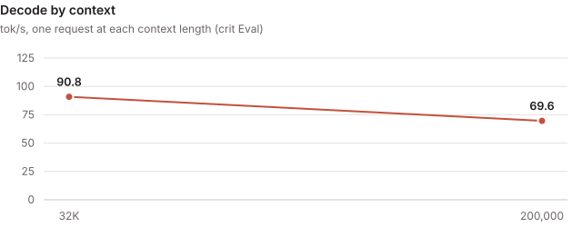
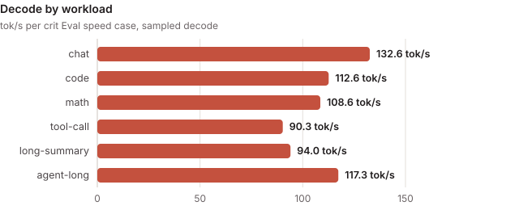

<!-- Rendered by tools/card.py from card.yaml: edit card.yaml, then run python -B tools/card.py on this folder. -->

# ranked-expert-cache-mtp3

### rtx5090 · qwen3.8-flash-next@FP4-Local

> [!NOTE]
> **Contributed by** [crit-labs](https://github.com/crit-labs)

| Quality mode | Decode (sampled) | Decode (greedy) | Prefill | TTFT | Perplexity | Mean KL divergence | Context |
| :---: | :---: | :---: | :---: | :---: | :---: | :---: | :---: |
| speed (rows: decode row-exact, prompt row-exact) | **108.3 tok/s** | **114.9 tok/s** | **1,487 tok/s** | **1.556 s** | **+9.5% vs reference** | **0.18** | **200,000 tok** |

- **Measured with:** crit Eval (crit-eval-v0.8.1, decode sampled at the model's defaults) · [crit-eval.json](evidence/crit-eval.json)
- **Track:** closed: either quality mode at its protocol budget, one configuration for every workload, and the checkpoint's own draft layers as its only drafter
- **Quality mode:** speed: drift from the checkpoint the user selected traded for speed, judged by a wider budget of its own that only keeps out a broken engine, whatever format the checkpoint is stored in; the worst path uses 61.9% of its quality budget; rows: decode row-exact, prompt row-exact ([exactness](https://github.com/crit-labs/crit/blob/main/kernels/README.md#exactness))
- **Hardware:** Ubuntu 24.04.4 LTS (WSL); AMD Ryzen 5 9600 6-Core Processor (6/12 cores); 79 GiB RAM; NVIDIA GeForce RTX 5090 32 GiB, PCIe 4.0 x16 (GPU supports 5.0)
- **Further figures:** long-context decode 79.5 tok/s · held-out decode 73.2 tok/s
- **Throughput:** 61.5 tok/s at concurrency 1 · 76.8 tok/s at concurrency 2 · 82.6 tok/s at concurrency 4 (aggregate of the concurrent requests; crit Eval)
- **Requires:** WSL2 · sm_120a · 32 GB GPU memory · CUDA 13.1 · crit Core plugin package, crit 0.23.0, torch 2.14.1+cu130, Triton 3.8.0; about 78 GB of host memory
- **Checkpoint** (`qwen3.8-flash-next@FP4-Local`): [`nvidia/Qwen3.8-Flash-Next-FP4-Local`](https://huggingface.co/nvidia/Qwen3.8-Flash-Next-FP4-Local/tree/b9ce18a6887e18c089fdea8509a33e63429a3300) at `b9ce18a6`
- **Source:** [crit-labs/crit-engines/ranked-expert-cache-mtp3 @ `4eb7da21`](https://github.com/crit-labs/crit-engines/tree/4eb7da21ce32c0a236efefac9fc4565ff34031f0/ranked-expert-cache-mtp3)
- **Built:** 13.12 h · 11 candidates · 207.5M agent tokens · $52.36 API-equivalent · by Claude Code
- **License:** Apache-2.0

- A crit plugin package for Qwen3.8-Flash-Next, a mixture-of-experts model with 512 routed experts, hybrid gated-delta and sparse attention layers, gated residual streams and n-gram embeddings; every plugin is a copy of crit's library (model plugin `qwen4-exp-model` over the models core `model-template`)
- Runs NVIDIA's FP4-Local checkpoint (117 GB: NVFP4 experts, MXFP8 attention and gated-delta projections, a 30 GB NVFP4 n-gram table) on one 32 GB GPU, judged in crit Eval's `speed` quality mode
- The routed experts (65 GB) live in host memory behind an elastic device cache; misses cross the PCIe link
- Drafts 3 tokens a round with the checkpoint's own MTP layer inside Core's captured rounds, with rejection sampling on the device
- 200,000 tokens of context, FP8 KV pages; closed track

---

## Design

| Slot | Plugin and settings |
| --- | --- |
| Model | `qwen4-exp-model` over `model-template`: the hybrid layout's 48 layers, the MTP layer as the device draft head (`mtp: true`), 2,048-token prompt chunks run layer by layer |
| Experts | `expert-offload`: the routed experts in host memory behind an elastic device cache of about 8,200 slots, ranked policy started from a residency profile (`engine/residency_profile.json`, routes recorded on a corpus written for the run), misses copied over the link by a 128-block fill kernel, 6 of the router's 10 routes a token kept (`keep_routes: 6`); `topk-router`: scored before selection, renormalized |
| Projections | `quantized-projections`: the stored NVFP4 and MXFP8 matrices; prompt rows on the decode tile (`prompt_gemm: tile`, `gemv: mma`), so decode rows match prefill over the whole checkpoint |
| Embeddings and placement | `lookup-table-rows`: the 30 GB n-gram and embedding tables read as file rows off the device; `device-placement`: tables off the device |
| KV cache and attention | `attention-state`: elastic FP8 pages; `partitioned-attention` |
| Recurrence | `sequential-recurrence` and `recurrent-state-recovery`, both elastic |
| Sampling and drafting | `token-constraints` in Core's native sampler; `greedy-head-drafter` width 3 and `chain-verifier` |
| Kernel tuning | `engine/tuning/`: mma-rows, grouped-experts, expert-directory and fused-norms tables from `crit kernels sweep` on the RTX 5090 |

---

## Measured



| Measurement | Value |
| :--- | ---: |
| Decode, sampled (temperature 1.0, top-p 0.95, top-k 20) | 108.3 tok/s |
| Decode, greedy | 114.9 tok/s |
| Tokens per decode round, sampled | 3.3 |
| Prefill | 1,487 tok/s, 37% of its ceiling |
| Time to first token | 1.6 s |
| Whole requests, end to end | 62.2 tok/s |
| Held-out prompts, decode | 73.2 tok/s |
| Long context, decode | 79.5 tok/s |
| Long context, first token | 27.6 s |
| Follow-up turn, first token | 453 ms |
| Perplexity vs reference, worst path | +9.5% (long-32768/served) |
| KL divergence, worst path | mean 0.181, p99 2.48 (long-32768/prompt) |
| Top-1 agreement, lowest | 86.3% (long-32768/prompt) |
| Quality budget used | 62% (long-32768/prompt) |
| Quality budget | PPL ×1.4, KLD mean 0.4, p99 4.0 |
| Verify pass | 25.7 ms, against 5.1 ms of reads (20%) |
| Draft step | 1.71 ms, against 1.06 ms of reads |
| Context | 200,000 tokens |
| VRAM free at the full context | 1.61 GB |
| Load time | 113.4 s |

| Speed case | Prompt tokens | Decode, sampled | Decode, greedy | Tokens per round | First token |
| :--- | ---: | ---: | ---: | ---: | ---: |
| chat | 87 | 132.6 tok/s | 130.2 tok/s | 2.8 | 498 ms |
| code | 97 | 112.6 tok/s | 103.6 tok/s | 3.4 | 510 ms |
| math | 213 | 108.6 tok/s | 115.0 tok/s | 3.6 | 774 ms |
| tool-call | 2,052 | 90.3 tok/s | 162.0 tok/s | 3.5 | 2.5 s |
| long-summary | 3,584 | 94.0 tok/s | 108.5 tok/s | 2.9 | 2.8 s |
| agent-long | 14,336 | 117.3 tok/s | 84.5 tok/s | 3.7 | 5.8 s |

| Context | Decode | First token | Prefill | Tokens per round |
| :--- | ---: | ---: | ---: | ---: |
| 32,768 | 90.8 tok/s | 9.8 s | 2,900 tok/s | 2.9 |
| 200,000 | 69.6 tok/s | 77.6 s | 2,574 tok/s | 3.0 |

- crit Eval (crit-eval-v0.8.1) of sealed candidate-0011 of run-20261123T155751Z-837036fd, certified, at 200,000 tokens of context, closed track
- Decode is sampled at the model's generation_config (temperature 1.0, top_p 0.95, top_k 20)
- A model pass takes 25.7 ms against a 5.1 ms floor priced from the placement's tiers: about 118 MB a pass comes from host memory at a 91% expert cache hit rate
- Decode reaches 23% of the 468 tok/s ceiling Eval prices for this drafter; time to first token is 74% of its floor
- Keeping 6 of 10 routes is the largest decode lever and spends the quality budget: the worst path (long-32768 prompt rows) uses 62% of it
- Greedy drafted output is token for token what plain greedy decoding produces (2 of 2 cases)



---

## Checks

- **Gates:** every gate of the certified Eval passed: coverage (6 of 6 speed cases), repeatable, request history, prompt cache, quality, sampling, capacity at 200,000 tokens, retrieval at 4K, 32K and 200K, lower context, concurrency and generality
- **Closed track:** the quality mode at its protocol budget, one engine load, and a draft step that reads no more than the checkpoint's own draft layer and head
- **Functional:** `crit run serve --check` passed the plugin tests, the serving checks, crit smoke at 200,000 and 49,152 tokens, a 200,000-token prompt with its slowest step at 0.73 s against the 1 s cancel grace, and device memory headroom
- **Switching:** a served candidate switch, this engine to another candidate and back, returned the same greedy reply

---

## Limits

- Needs about 78 GB of host memory for the expert store; a first load rebuilds the 65 GB store, about 10 minutes
- A freshly opened engine is slow to settle: decode rises 18% to 103% over its first requests; a reopen in the same host re-reads the expert store and leaves the file-backed n-gram rows cold
- Concurrency is weak: four clients together reach 83 tok/s, since every client's rows add expert misses over the same link
- A prompt that fills 200,000 tokens gets its first token after about 78 s
- The prompt rows' decode tile runs at 0.74x the library's prompt GEMM; the library's default prompt rows drift 0.60 nats from decode over 48 layers on this checkpoint
- Tested only on WSL2 Ubuntu 24.04 with torch 2.14.1+cu130, Triton 3.8.0 and the CUDA 13.1 toolkit, on one RTX 5090 with PCIe 4.0 x16

---

## Build and chat

```sh
git clone https://github.com/crit-labs/crit-engines && git -C crit-engines checkout 4eb7da21ce32c0a236efefac9fc4565ff34031f0
crit pull crit-labs/ranked-expert-cache-mtp3
crit serve --engine crit-labs/ranked-expert-cache-mtp3
```

- `engine/` is a plugin package: crit's plugin loader assembles it from `engine/configuration.json`, and crit's kernels compile at load
- Needs a Python environment with crit 0.23.0, torch 2.14.1+cu130 and Triton 3.8.0
- Check the checkpoint from a crit-hub checkout: `python -B tools/verify_model.py engines/crit-labs/ranked-expert-cache-mtp3 /path/to/checkpoint`
- Chat at `http://127.0.0.1:8000/v1` (OpenAI-compatible)

---

## Benchmark your machine

```sh
crit pull crit-labs/ranked-expert-cache-mtp3
crit bench crit-labs/ranked-expert-cache-mtp3 --data <a folder for crit Eval's data> --out result.json
crit hub report crit-labs/ranked-expert-cache-mtp3 result.json --hub <your crit-hub checkout> --by <your GitHub account>
```

- `crit bench` prepares crit Eval's data from the checkpoint `crit pull` installed, runs its speed suite (and quality
  where the data holds the reference's scores) and prints this card's stats beside yours
- `crit hub report` adds your result file under `evidence/` and to this card, as a reproduction of the GPU and model
  it measured or as a new result, for a pull request to crit-hub

---

## Credits

Credits and licenses are in [THIRD_PARTY.md](https://github.com/crit-labs/crit-engines/blob/4eb7da21ce32c0a236efefac9fc4565ff34031f0/ranked-expert-cache-mtp3/THIRD_PARTY.md) and [LICENSES.txt](https://github.com/crit-labs/crit-engines/blob/4eb7da21ce32c0a236efefac9fc4565ff34031f0/ranked-expert-cache-mtp3/LICENSES.txt), next to the source. The checkpoint is under the NVIDIA Open Model Agreement, its base model under the Qwen Community License 1.0.
